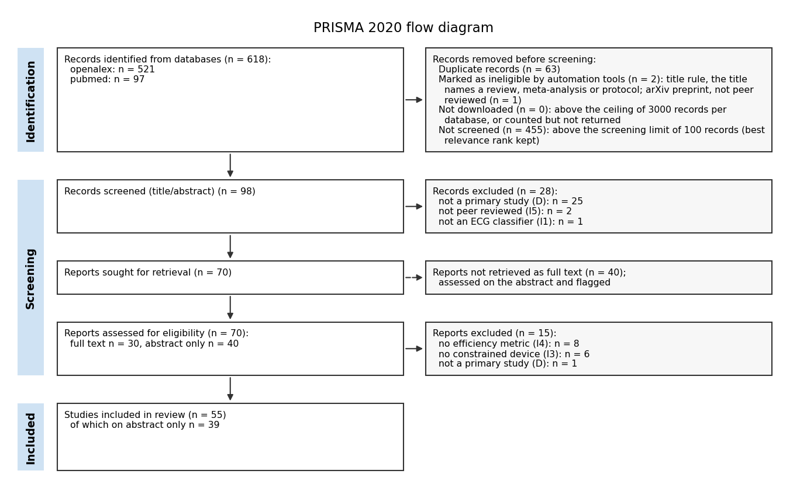
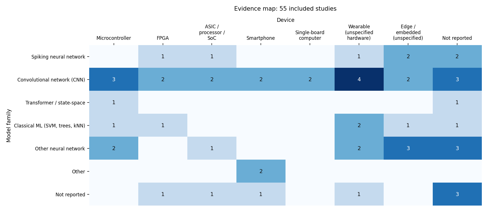

# Lightweight Machine-Learning Models for ECG Classification

*Draft systematic review produced by an agentic AI pipeline (PRISMA 2020 structure). A reviewer must check it before use. The Introduction, Discussion, Conclusions and parts of the abstract were drafted by an AI writer from the review's own tables; every number was checked by code (Appendix A).*

## Abstract

**Background.** The detection of abnormal versus normal ECG using lightweight machine-learning models on resource-constrained devices is crucial for advancing portable health monitoring technologies. This review aims to systematically evaluate the available studies on this topic to determine the models' accuracy and efficiency.

**Methods.** We searched OpenAlex, PubMed (2021 onward). LLM agents screened titles, abstracts and full texts against pre-specified criteria (two screeners and an adjudicator, every exclusion backed by a verified quote), extracted data with verified quotes and assessed risk of bias with the five-domain instrument of Arredondo-Velazquez 2026 (Table 2); narrative synthesis with an evidence map (no pooling).

**Results.** A total of 55 studies were included, with 39 assessed solely on their abstracts. The accuracy of the models reported ranged from 82% to 99.1%, while efficiency metrics were evaluated in terms of latency, power, memory, and operations across various studies.

**Conclusions.** The findings highlight a significant reliance on abstract assessments, which may limit the comprehensiveness of the review. Further research with full-text evaluations is necessary to enhance the understanding of model performance in this domain.

## Introduction

The increasing prevalence of cardiovascular diseases necessitates effective monitoring solutions, particularly in resource-constrained environments. Lightweight machine-learning models have emerged as promising tools for detecting abnormal ECG signals on devices such as microcontrollers, wearables, smartphones, and FPGAs, which are essential for real-time health monitoring.

Despite the potential of these models, there is a lack of systematic reviews that comprehensively assess their performance in terms of accuracy and efficiency. This review aims to fill this gap by evaluating the existing literature on lightweight machine-learning models for ECG detection, focusing on their application in resource-constrained devices.

## Methods

### Protocol and eligibility criteria

Review question: Which lightweight machine-learning models detect abnormal versus normal ECG on resource-constrained devices (microcontroller, wearable, smartphone, FPGA), and how accurate and efficient are they?

Outcomes of interest: abnormal versus normal ECG; accuracy; efficiency.

Study designs: no restriction. Years: 2021 onward. Languages: English. Eligibility criteria (the study must meet every inclusion criterion):

- **D** A primary study reporting its own results, any design (reviews, meta-analyses incl. network meta-analyses, study protocols without results, editorials and letters do not meet D)
- **I1** Machine-learning model that classifies ECG signals or heartbeats
- **I2** The model separates abnormal from normal ECG (binary output, or abnormal classes reported against normal)
- **I3** Model evaluated for or on a resource-constrained device (microcontroller, wearable, smartphone or FPGA)
- **I4** At least one efficiency metric reported (model size, memory, latency, power or energy) *(full text only)*
- **I5** Peer-reviewed journal or conference publication

The protocol (question, criteria, outcomes, databases) was drafted by an LLM planner and fixed before the search; it is published with this review (`protocol.json`). Where the criteria came from is given in Appendix A.

### Information sources and search strategy

Databases: OpenAlex, PubMed (Relevant for health and machine learning research). The LLM proposes the search concepts; code builds each database's Boolean query and design filter, checks the hit counts before any download, and refines at most twice.

| Database | Searched (UTC) | Hits | Downloaded | Not downloaded | Query |
|---|---|---|---|---|---|
| OpenAlex | 2026-11-08T18:11:25+00:00 | 521 | 521 | 0 | (ECG OR electrocardiogram OR heartbeats OR "cardiac signals" OR "heart rhythm") AND ("lightweight models" OR "machine learning" OR ML OR AI OR "neural networks" OR "classification models") AND (microcontroller OR MCU OR embedded OR "edge device" OR "edge computing" OR "edge AI" OR wearable OR smartphone OR "mobile phone" OR FPGA OR ASIC OR SoC OR "system on chip" OR TinyML OR low-power OR "low power" OR quantized OR quantization OR on-device OR resource-constrained) AND ("abnormal ECG" OR "normal ECG" OR "ECG classification" OR "arrhythmia detection" OR "ECG diagnosis") |
| PubMed | 2026-11-08T18:11:25+00:00 | 97 | 97 | 0 | (ECG[tiab] OR electrocardiogram[tiab] OR heartbeats[tiab] OR "cardiac signals"[tiab] OR "heart rhythm"[tiab] OR Electrocardiography[mh]) AND ("lightweight models"[tiab] OR "machine learning"[tiab] OR ML[tiab] OR AI[tiab] OR "neural networks"[tiab] OR "classification models"[tiab] OR "Machine Learning"[mh]) AND (microcontroller[tiab] OR MCU[tiab] OR embedded[tiab] OR "edge device"[tiab] OR "edge computing"[tiab] OR "edge AI"[tiab] OR wearable[tiab] OR smartphone[tiab] OR "mobile phone"[tiab] OR FPGA[tiab] OR ASIC[tiab] OR SoC[tiab] OR "system on chip"[tiab] OR TinyML[tiab] OR low-power[tiab] OR "low power"[tiab] OR quantized[tiab] OR quantization[tiab] OR on-device[tiab] OR resource-constrained[tiab]) AND ("abnormal ECG"[tiab] OR "normal ECG"[tiab] OR "ECG classification"[tiab] OR "arrhythmia detection"[tiab] OR "ECG diagnosis"[tiab]) |

### Selection process

Records were deduplicated by code (record id, DOI, PMID, PMCID, then fuzzy title match with guards). Only the 100 best-ranked unique records were screened (screening limit; rank = best position in any database's relevance order, so every database contributes its top hits); the other 455 are reported in the flow diagram as not screened. Automation tool (PRISMA 2020 'records marked as ineligible by automation tools'): before any LLM call, a code rule excludes on the design criterion D a record whose title names its own type as a review, meta-analysis, protocol, editorial or commentary (at the start of the title or after a colon or dash, e.g. '...: a systematic review'), and, when a criterion requires peer review, a record with an arXiv DOI (10.48550) is excluded on it; these records are counted before screening, not as screening exclusions. Two LLM screeners (A strict, B lenient) judged every record criterion by criterion, each failure backed by a quote that code verifies in the text; disagreements went to an LLM adjudicator, unresolved records to a human (or were included with `--auto`). Full texts (open access only: PMC XML, open PDFs) were indexed (FAISS + BM25, LLM re-ranking) and the screeners read the best passages per criterion; papers without a full text were assessed on the abstract and flagged. The screening rules were tuned on a separate development topic and frozen before this review (Appendix A).

### Data items

For every included study the following items were extracted, each with the sentence that supports it:

- **dataset**: ECG database(s) used (e.g. MIT-BIH, PTB-XL, INCART) and number of records or subjects
- **classes**: Classes the model outputs and their number (e.g. AAMI N, S, V, F, Q; normal vs abnormal)
- **partition**: Evaluation protocol as stated: how data were split between training and test (inter-patient, intra-patient / random beats, patient-specific)
- **model**: Model family and topology (e.g. 1D-CNN, LSTM, SVM, spiking network, transformer)
- **operations**: Operation count per classification (MACs, OPs or FLOPs, as printed)
- **parameters**: Parameter count of the deployed model
- **arithmetic**: Arithmetic width of the deployed model (e.g. float32, int8, binary, fixed point)
- **memory**: Memory footprint of the deployed model (kB), and peak activation memory if given
- **platform**: Target hardware platform and technology (microcontroller, FPGA, ASIC node, SoC, smartphone), as named
- **clock**: Clock frequency of the target (MHz)
- **latency**: Inference latency or time per classification on the target
- **power energy**: Power consumption and/or energy per classification on the target
- **classification metrics**: All classification metrics reported (accuracy, sensitivity, specificity, PPV, F1, per class if given), and whether they are for the deployed variant or the software model

### Data collection and risk of bias

Fields were derived from the protocol (PICO, design, sample size, outcomes and results). A value was kept only with a quote found in the passages shown and every number of the value printed in that quote; otherwise it is `not reported` (values are never computed or invented). Risk of bias was assessed for every study with the review's own instrument (Five-domain instrument of Arredondo-Velazquez 2026 (Table 2): D1 Evaluation protocol stated; D2 Subjects separated between training and test; D3 Per-class or prevalence-insensitive metric; D4 Deployed variant evaluated; D5 Model size reported); a domain without a verified quote is scored unclear.

### Synthesis methods

Continuous outcomes were pooled (random effects, DerSimonian-Laird; Hedges' g from post-intervention means) only with at least 3 studies reporting verified per-arm n, mean and SD; the 95% prediction interval is given when k >= 3, and a pooled result with I2 >= 75% is reported as not interpretable as a single effect. Otherwise the synthesis follows SWiM (Campbell 2020): grouping by outcome, direction of effect as the standardised metric, vote counting with a sign test, heterogeneity described. Only between-group results give a direction; the metric order was pre-specified (between group estimate, post means, change means), and a study whose metrics disagree is flagged. Diagnostic studies: sensitivity and specificity with Wilson 95% CIs; pooled (univariate logit random effects) with at least 3 studies. A critic agent checked the text (code checks plus an LLM pass); blockers sent it back to synthesis at most 2 times. An LLM objection counted as a blocker only when code confirmed the wrong value.

Because the studies report different measures on different datasets, no effect was pooled across them. The studies were mapped by model family and device (evidence map): each value was put in the first group whose keyword it contains, a study whose value was not reported was classified from its title, and the rest are shown as Other or Not reported. Numeric items (e.g. latency, power) are shown only when the extracted value contains a number.

### Use of automation tools

Every step after the protocol was carried out by LLM agents (gpt-4o-mini, temperature 0) under code checks: the search, screening (two screeners and an adjudicator), extraction, risk of bias, the synthesis and a critic. A person approved the protocol and settled the disagreements the adjudicator could not, unless the run was fully automatic. Agents, models, cache use and cost are listed in Appendix A.

## Results

### Study selection

618 records were identified; 63 duplicates, 2 records marked as ineligible by automation tools (title rule, arXiv rule), 0 records not downloaded (search ceiling) and 455 records above the screening limit of 100 (not screened) were removed before screening. 98 records were screened on title and abstract and 28 excluded. 70 reports were sought; 40 had no open-access full text and were assessed on the abstract. 15 were excluded and **55 studies were included**. Screener agreement: title/abstract kappa 0.0568, full text kappa 0.7429.

### Study characteristics

Values as extracted, each backed by a sentence of the paper (see `tables/extraction.csv`); – = not reported (numeric items: no number given).

| Study | Model | Device | Dataset | Train/test split | Reported metrics | Latency | Power / energy | Memory | Text used |
|---|---|---|---|---|---|---|---|---|---|
| S1 Sundar 2026 | – | wearable ECG devices | – | – | – | – | – | – | abstract only † |
| S2 Farag 2023 | Tiny convolutional neural network (CNN). | Raspberry Pi. | MIT-BIH dataset. | Inter-patient. | Accuracy: 98.18%, Sensitivity: 91.90%, F1: 92.17%. | – | – | – | full text |
| S3 Fan 2024 | TD based SNN processor | – | – | – | accuracy of 96.8% | – | – | – | abstract only † |
| S4 Zhang 2023 | – | – | – | – | – | – | – | – | abstract only † |
| S5 SHANMUGA SUNDARI M 2026 | 1D-CNN | Raspberry Pi 4 | MIT-BIH Arrhythmia Database | – | accuracy: 98.72 %, precision: 97.85 %, recall: 98.10 %, F1-score: 0.981 | – | – | – | abstract only † |
| S6 Rahman 2025 | – | – | – | – | – | – | – | – | full text |
| S7 Wang 2021 | neural network model | STM32 development board | – | – | – | – | – | – | abstract only † |
| S8 Pillai 2025 | Weightless Neural Network (WNN) model, arrDWNN | 45 nm CMOS technology | MIT-BIH arrhythmia database | – | accuracy of 89 % | – | under 4.24 mW of power | – | abstract only † |
| S9 Zahid 2023 | – | – | MIT-BIH arrhythmia benchmark database | – | Precision, recall, F1-score for normal (N), SVEBs, VEBs - deployed variant | – | – | – | abstract only † |
| S10 Kang 2025 | Spiking Neural Networks (SNNs) | – | MIT-BIH Arrhythmia and MIT-BIH Supraventricular Arrhythmia datasets | – | – | – | 0.07µJ | – | abstract only † |
| S11 Okoror 2026 | 90–8–1 multilayer perceptron | ESP32-S3 | MIT-BIH Arrhythmia Database, 84,708 annotated beats | GroupShuffleSplit with 30% test proportion | accuracy: 86.27%, F1-score: 53.94% (floating-point); accuracy: 86.28%, F1-score: 53.98% (… | 0.38 μs | – | 1,500 bytes for model constants, 130 bytes for working memory | full text |
| S12 Nandini 2025 | – | Xilinx PYNQ FPGA platform | – | – | – | – | – | – | full text |
| S13 Lal 2023 | SVM, KNN, Neural Networks | – | Publicly available database | – | Accuracy of 82% for SVM classifier | – | – | – | abstract only † |
| S14 Sancho 2023 | – | wearable devices | – | – | – | – | – | – | abstract only † |
| S15 Tran 2026 | 1D CNN | FPGA | – | – | classification accuracy, sensitivity, precision | – | – | – | abstract only † |
| S16 Vinod 2026 | lightweight convolutional neural network (CNN) | ESP32-S3 microcontroller | – | – | – | – | – | – | full text |
| S17 J 2026 | lightweight deep learning model | edge device | – | – | – | – | – | – | abstract only † |
| S18 Bhandari 2025 | SNN (Spiking Neural Network) | – | MIT-BIH Arrhythmia, PTB Diagnostic ECG, ECG Heartbeat Categorization | – | – | – | – | – | abstract only † |
| S19 Thanh 2026 | – | – | MIT-BIH Arrhythmia Database. | – | – | – | – | – | abstract only † |
| S20 Shrirao 2026 | 1D CNN | – | MIT-BIH arrhythmia database | – | – | 7.8 ms | – | 29.6 kB | full text |
| S21 Han 2023 | – | – | – | – | – | – | – | – | abstract only † |
| S22 Mukhopadhyay 2023 | – | – | – | – | – | – | – | – | abstract only † |
| S23 RYO 2026 | – | resource-constrained embedded platforms | MIT-BIH Arrhythmia Database | randomly divided into 70% training, 15% validation, and 15% testing | accuracy ranging from 94.0% to 97.5%, 96.8% precision, 96.3% recall, 96.5% F1-score | below 100 ms | – | less than 100 KB | full text |
| S24 Banjo 2026 | Quantized Convolutional Spiking Neural Network (QCSNN). | PYNQ-Z2 FPGA. | MIT-BIH Arrhythmia Database. | – | – | 11.54 ms. | 0.33 W. | – | full text |
| S25 Geng 2025 | – | – | – | – | – | – | – | – | abstract only † |
| S26 Devi 2025 | lightweight blocks of neural networks | wearable devices | standard ECG datasets | – | – | – | – | – | abstract only † |
| S27 Gonawala 2025 | – | – | – | – | – | – | – | – | abstract only † |
| S28 Pham 2025 | – | FPGA. | – | – | – | – | – | – | abstract only † |
| S29 Meng 2026 | lightweight SNN with three convolutional layers, three fully connected layers, and a skip… | wearable devices | MIT-BIH | – | accuracy of 93.7 %, kappa coefficient of 0.706 | – | – | – | abstract only † |
| S30 Cong 2024 | 2-input deep learning model with CNN and DNN architecture. | microcontroller. | MIT-BIH dataset. | – | accuracy: 97.34%, F1-score: 0.96. | – | – | 143 KB. | abstract only † |
| S31 Hammad 2024 | K-Nearest Neighbors (KNN), Random Forest (RF), Logistic Regression (LR) | – | – | – | 93.66%, 80.53%, 70.87% for RF, KNN, LR respectively | – | – | – | abstract only † |
| S32 Tao 2023 | – | – | – | – | – | – | – | – | abstract only † |
| S33 Chen 2024 | Ensemble Multiscale Convolutional Neural Network | – | – | – | – | – | – | – | abstract only † |
| S34 Rosengarten 2023 | – | – | – | – | – | – | – | – | abstract only † |
| S35 Lee 2025 | 1-D convolutional neural network | mobile health (mHealth) applications | MIT-BIH Arrhythmia database | inter-patient and intra-patient | accuracy: 94.82% | 155 μs | – | – | abstract only † |
| S36 Ismail 2023 | 1D Temporal Convolutional Network (TCN) | low cost embedded devices | ECG5000 dataset (5000 heartbeats) | inter-patient | – | – | – | – | full text |
| S37 Sadeghi 2024 | residual architecture with multi-head attention. | – | – | – | micro F1-score of 80.3 %. | – | – | – | abstract only † |
| S38 Panwar 2025 | – | Arduino Nano microcontroller. | MIT-BIH Arrhythmia Database. | – | – | 173 ms for binary classification; 218 ms for multi-class classification. | – | – | full text |
| S39 Deng 2024 | – | Wearable devices. | – | – | Accuracy: 97.95%. | – | 12.94 μW. | 12.5 KB. | full text |
| S40 Talukder 2025 | CNN and DNN. | – | MITDB, NSTDB, PTBDB. | – | – | – | – | – | full text |
| S41 Singh 2026 | linear support vector classifier | wearable and bedside decision-support systems | MIT-BIH, INCART | inter-patient | weighted F1 score: SVC 0.844, logistic regression 0.847 | – | – | 2.17 KB | abstract only † |
| S42 Mantravadi 2024 | convolution, LSTM and involution layers | smart wearable devices | – | – | – | – | – | – | abstract only † |
| S43 Khalid 2026 | LightGBM. | – | MIT-BIH, PTB-XL, Chapman. | – | F1 score of 0.928, AUC of 0.985. | 8.1 ms. | 95 µJ. | – | full text |
| S44 Li 2023 | dilated residual neural network. | – | PhysioNet/CinC 2017 Challenge, MIT-BIH Atrial Fibrillation Database. | – | – | – | – | – | abstract only † |
| S45 Wu 2025 | CTM-based all-hardware RC system. | Edge AI devices. | MIT-BIH arrhythmia dataset with 48 recordings. | 80% training and 20% testing. | class-specific accuracies ranging from 88 to 97.1%. | – | – | – | full text |
| S46 Dózsa 2024 | variable projection support vector machine (VP-SVM) | microcontroller | – | – | – | – | – | – | abstract only † |
| S47 Faraone 2021 | Convolutional-recurrent neural network | nRF52832 System-on-Chip from Nordic Semiconductors | – | – | F1 score: 0.779 to 0.828 | – | – | – | abstract only † |
| S48 Yang 2025 | – | – | MIT-BIH and PTB datasets | – | accuracy: 89.08% with logistic regression, 91.42% with Gradient Boosting Trees | – | – | – | abstract only † |
| S49 Cao 2025 | lightweight MambaOut architecture | microcontroller unit (MCU) | MIT-BIH | – | accuracy: 98.75% | – | 8.08 mJ per heartbeat classification | 54.4 KB Flash, 10.25 KB RAM | abstract only † |
| S50 Qiang 2024 | Convolutional Residual Graph Neural Network (Conv-RGNN). | – | two multi-label datasets and one single-label dataset. | – | – | – | – | – | abstract only † |
| S51 Thapa 2025 | ResNet-18, CNN-Transformer, ViT | wearable ECG devices or mobile health apps | PhysioNet Challenge 2017 dataset, 8528 records | – | F1-score, ROC-AUC | – | – | – | full text |
| S52 Sahu 2022 | – | Wearable and implantable devices. | – | – | – | – | – | – | abstract only † |
| S53 Tang 2026 | elementwise-product enhanced lightweight model (EPLM). | Raspberry Pi 5 and smartphone. | MIT-BIH, SVDB, INCART, and PTB databases. | – | accuracy: 99.10% (MIT-BIH), 98.85% (PTB). | 2.29 ms. | – | – | abstract only † |
| S54 Menon 2023 | Fourier series-based template matching algorithm | wearable devices or smartphones | – | – | sensitivity 99%, specificity 98.9%, accuracy 98.9% | – | – | 700 kB | full text |
| S55 Yaser 2025 | Temporal Convolutional Networks (TCN) and Graph Convolutional Networks (GCN). | – | Chapman and Shaoxing 12-lead ECG database. | – | Classification accuracy of 95.5%. | – | – | – | abstract only † |

### Evidence map

Each of the 55 included studies is counted once, by model family and device. Model family: from the extracted value for 36 studies, from the title for 12; device: from the value for 31, from the title for 11.

| Model family \ Device | Microcontroller | FPGA | ASIC / processor / SoC | Smartphone | Single-board computer | Wearable (unspecified hardware) | Edge / embedded (unspecified) | Not reported | Total |
|---|---|---|---|---|---|---|---|---|---|
| Spiking neural network |  | 1 (S24) | 1 (S3) |  |  | 1 (S29) | 2 (S10, S45) | 2 (S18, S25) | 7 |
| Convolutional network (CNN) | 3 (S16, S30, S38) | 2 (S15, S28) | 2 (S20, S47) | 2 (S35, S51) | 2 (S2, S5) | 4 (S14, S33, S39, S42) | 2 (S19, S36) | 3 (S40, S50, S55) | 20 |
| Transformer / state-space | 1 (S49) |  |  |  |  |  |  | 1 (S37) | 2 |
| Classical ML (SVM, trees, kNN) | 1 (S46) | 1 (S27) |  |  |  | 2 (S13, S41) | 1 (S43) | 1 (S31) | 6 |
| Other neural network | 2 (S7, S11) |  | 1 (S8) |  |  | 2 (S26, S52) | 3 (S17, S21, S23) | 3 (S9, S22, S44) | 11 |
| Other |  |  |  | 2 (S53, S54) |  |  |  |  | 2 |
| Not reported |  | 1 (S12) | 1 (S6) | 1 (S32) |  | 1 (S1) |  | 3 (S4, S34, S48) | 7 |
| **Total** | 7 | 5 | 5 | 5 | 2 | 10 | 8 | 13 | **55** |

### Summary of findings

- 55 studies were included; 39 of them were assessed on the abstract only (no open-access full text).
- Most frequent model and device combinations: Convolutional network (CNN) on Wearable (unspecified hardware) (4 studies); Convolutional network (CNN) on Microcontroller (3 studies); Convolutional network (CNN) on Single-board computer (2 studies).
- Dataset named in 29 studies: MIT-BIH Arrhythmia 23, Other 4, PhysioNet/CinC 2017 1, Chapman / Shaoxing 1.
- Train/test split stated in 7 studies: inter-patient 4, other wording 2, intra-patient / random 1.
- An accuracy figure is reported by 16 studies (S2, S3, S5, S8, S11, S13, S23, S29, S30, S35, S39, S48, S49, S53, S54, S55); the figures range from 82% to 99.1%. They are not comparable: datasets, train/test splits and class sets differ.
- Efficiency measured with a number: latency 8, power / energy 6, memory 8, parameters 8, operations 3 of 55 studies.
- Risk of bias (overall): unclear 46, high 9.

### Risk of bias

Overall: unclear 46, high 9. Per-study judgements are in Appendix B.

| Domain | Low | Unclear | High |
|---|---|---|---|
| D1 Evaluation protocol stated | 10 | 45 | 0 |
| D2 Subjects separated between training and test | 9 | 44 | 2 |
| D3 Per-class or prevalence-insensitive metric | 13 | 36 | 6 |
| D4 Deployed variant evaluated | 4 | 50 | 1 |
| D5 Model size reported | 18 | 37 | 0 |

### Synthesis of results

**O1: abnormal versus normal ECG** (better = unknown values). Method: narrative (SWiM) (0 study(ies) with per-arm n, mean and SD (< 3 needed for a meta-analysis): vote counting by direction of effect). Vote count: favours intervention 0, favours control 0, no difference 0, not extractable 55, sign test p n/a.

**O2: accuracy** (better = higher values). Method: narrative (SWiM) (0 study(ies) with per-arm n, mean and SD (< 3 needed for a meta-analysis): vote counting by direction of effect). Vote count: favours intervention 2, favours control 0, no difference 0, not extractable 53, sign test p 0.500.

**O3: efficiency** (better = higher values). Method: narrative (SWiM) (0 study(ies) with per-arm n, mean and SD (< 3 needed for a meta-analysis): vote counting by direction of effect). Vote count: favours intervention 0, favours control 0, no difference 0, not extractable 55, sign test p n/a.

Narrative synthesis (written by the synthesis agent, every number and study label checked by code):

#### O1: abnormal versus normal ECG

The studies were grouped based on their reported outcomes related to abnormal versus normal ECG classification, with no studies providing sufficient data for a meta-analysis, leading to a vote counting by direction of effect [S1†, S2, S3†, S4†, S5†, S6, S7†, S8†, S9†, S10†, S11, S12, S13†, S14†, S15†, S16, S17†, S18†, S19†, S20, S21†, S22†, S23, S24, S25†, S26†, S27†, S28†, S29†, S30†, S31†, S32†, S33†, S34†, S35†, S36, S37†, S38, S39, S40, S41†, S42†, S43, S44†, S45, S46†, S47†, S48†, S49†, S50†, S51, S52†, S53†, S54, S55†].

*Heterogeneity.* The studies differ in their reported measures, with some focusing on ECG classification accuracy, while others report various performance metrics without clear direction of effect [S1†, S2, S3†, S4†, S5†, S6, S7†, S8†, S9†, S10†, S11, S12, S13†, S14†, S15†, S16, S17†, S18†, S19†, S20, S21†, S22†, S23, S24, S25†, S26†, S27†, S28†, S29†, S30†, S31†, S32†, S33†, S34†, S35†, S36, S37†, S38, S39, S40, S41†, S42†, S43, S44†, S45, S46†, S47†, S48†, S49†, S50†, S51, S52†, S53†, S54, S55†].

#### O2: accuracy

The studies were grouped based on their reported accuracy metrics, with no studies providing sufficient data for a meta-analysis, leading to a vote counting by direction of effect [S1†, S2, S3†, S4†, S5†, S6, S7†, S8†, S9†, S10†, S11, S12, S13†, S14†, S15†, S16, S17†, S18†, S19†, S20, S21†, S22†, S23, S24, S25†, S26†, S27†, S28†, S29†, S30†, S31†, S32†, S33†, S34†, S35†, S36, S37†, S38, S39, S40, S41†, S42†, S43, S44†, S45, S46†, S47†, S48†, S49†, S50†, S51, S52†, S53†, S54, S55†].

*Heterogeneity.* The studies differ in their reported accuracy metrics, with some providing accuracy percentages while others report sensitivity and specificity without a clear direction of effect [S1†, S2, S3†, S4†, S5†, S6, S7†, S8†, S9†, S10†, S11, S12, S13†, S14†, S15†, S16, S17†, S18†, S19†, S20, S21†, S22†, S23, S24, S25†, S26†, S27†, S28†, S29†, S30†, S31†, S32†, S33†, S34†, S35†, S36, S37†, S38, S39, S40, S41†, S42†, S43, S44†, S45, S46†, S47†, S48†, S49†, S50†, S51, S52†, S53†, S54, S55†].

#### O3: efficiency

The studies were grouped based on their reported efficiency metrics, with no studies providing sufficient data for a meta-analysis, leading to a vote counting by direction of effect [S1†, S2, S3†, S4†, S5†, S6, S7†, S8†, S9†, S10†, S11, S12, S13†, S14†, S15†, S16, S17†, S18†, S19†, S20, S21†, S22†, S23, S24, S25†, S26†, S27†, S28†, S29†, S30†, S31†, S32†, S33†, S34†, S35†, S36, S37†, S38, S39, S40, S41†, S42†, S43, S44†, S45, S46†, S47†, S48†, S49†, S50†, S51, S52†, S53†, S54, S55†].

*Heterogeneity.* The studies differ in their reported efficiency metrics, with some focusing on energy consumption while others report latency and computational efficiency without a clear direction of effect [S1†, S2, S3†, S4†, S5†, S6, S7†, S8†, S9†, S10†, S11, S12, S13†, S14†, S15†, S16, S17†, S18†, S19†, S20, S21†, S22†, S23, S24, S25†, S26†, S27†, S28†, S29†, S30†, S31†, S32†, S33†, S34†, S35†, S36, S37†, S38, S39, S40, S41†, S42†, S43, S44†, S45, S46†, S47†, S48†, S49†, S50†, S51, S52†, S53†, S54, S55†].

#### Overall

The evidence is limited by the high number of studies with unclear risk of bias (46 out of 55), and the majority of studies were extracted from abstracts, which may affect the reliability of the findings [S1†, S2, S3†, S4†, S5†, S6, S7†, S8†, S9†, S10†, S11, S12, S13†, S14†, S15†, S16, S17†, S18†, S19†, S20, S21†, S22†, S25†, S26†, S27†, S28†, S29†, S30†, S31†, S32†, S33†, S34†, S35†, S36, S37†, S38, S39, S40, S41†, S42†, S43, S44†, S45, S46†, S47†, S48†, S49†, S50†, S51, S52†, S53†, S54, S55†].

† Data extracted from the abstract only (no open-access full text).

## Discussion

The review identified 55 studies that explored various lightweight machine-learning models for ECG detection, with a notable emphasis on convolutional networks across different devices. The reported accuracy figures, ranging from 82% to 99.1%, indicate a wide variability in model performance, influenced by differing datasets, train/test splits, and class sets, which complicates direct comparisons between studies.

A significant limitation of this review is the high number of studies (39 out of 55) that were assessed based solely on abstracts, which raises concerns about the completeness and reliability of the extracted data. Additionally, the overall risk of bias was deemed unclear for 46 studies, suggesting that many findings may lack robust validation due to insufficient reporting in the available texts.

Future research should aim to include full-text evaluations to provide a more comprehensive understanding of model performance. Furthermore, expanding the search to include additional databases could uncover relevant studies that were not indexed in the current review, thereby enriching the evidence base for lightweight machine-learning models in ECG detection.

### Limitations

- Databases searched: OpenAlex, PubMed only (free sources); reviews that also search Embase, Cochrane or Scopus may find studies these do not index.
- Screening limit: only the 100 best-ranked of 555 unique records were screened; relevant studies among the other 455 were not considered.
- 39 of 55 included studies had no open-access full text and were screened and extracted from the abstract only (S1, S3, S4, S5, S7, S8, S9, S10, S13, S14, S15, S17, S18, S19, S21, S22, S25, S26, S27, S28, S29, S30, S31, S32, S33, S34, S35, S37, S41, S42, S44, S46, S47, S48, S49, S50, S52, S53, S55, marked †).
- Extraction values need a verified quote: correct values paraphrased by the model are refused and reported as `not reported` (conservative, lowers completeness).
- Risk of bias used the review's own instrument; a domain without a verified quote is scored unclear, so 'unclear' often means 'not reported in the text read'.
- Screening, extraction and synthesis are done by LLM agents with code checks; a human checked only the steps where the run paused for approval.

## Conclusions

This systematic review highlights the potential of lightweight machine-learning models for ECG detection on resource-constrained devices, while also revealing significant limitations in the current literature. Enhanced research efforts are needed to validate these findings and improve the reliability of model assessments.

## Other information

- **Registration and protocol.** Not registered. The protocol is published with the review (`protocol.json`); where its criteria came from is in Appendix A.
- **Support and competing interests.** [to be completed by the authors]
- **Availability of data.** Evidence tables, extracted values with their quotes, screening decisions and the BibTeX file are published with the review (`tables/`, `references.bib`).
- **Use of AI.** This draft was produced by LLM agents under code checks; every number in the text comes from the tables. A reviewer must check it before use.

## Included studies

- **S1** R. Sundar, Avinash Deyyam, Anusha N et al. (2026). Edge AI Architecture for Real-Time Arrhythmia Detection Using Wearable ECG Devices. International Conference Trends Material Science and Inventive Materials doi:10.1109/ictmim68190.2026.11507301
- **S2** Mohammed M Farag (2023). A Tiny Matched Filter-Based CNN for Inter-Patient ECG Classification and Arrhythmia Detection at the Edge. Sensors (Basel, Switzerland) doi:10.3390/s23031365
- **S3** Haodong Fan, Liang Chang, Junlu Zhou et al. (2024). An Ultra-Low Power Time-Domain based SNN Processor for ECG Classification. IEEE International Symposium on Circuits and Systems proceedings doi:10.1109/iscas58744.2024.10558014
- **S4** Shuo Zhang, Qianfang Sun, Lingfeng Yao et al. (2023). Feature Detection Algorithm Combined with Machine Learning Applied to Abnormal ECG Diagnosis System. Smart innovation, systems and technologies doi:10.1007/978-981-19-7184-6_17
- **S5** SHANMUGA SUNDARI M , T. LAKSHMI PRAVEENA , PUSHPA BHUPATIRAJU , ASHA VUYYURU , BUKKACHARLA KISHORE KUMAR , B. GOVARDHAN SIVA SAI (2026). REAL-TIME ARRHYTHMIA DETECTION FROM WEARABLE ECG DEVICES USING LIGHTWEIGHT 1D CNN AND EDGE AI DEPLOYMENT. Journal of Theoretical and Applied Information Technology doi:10.5281/zenodo.18666630
- **S6** Mahfuzur Rahman, Bashir I. Morshed (2025). Resource-Constrained On-Chip AI Classifier for Beat-by-Beat Real-Time Arrhythmia Detection with an ECG Wearable System. Electronics doi:10.3390/electronics14132654
- **S7** Bocheng Wang, Guorong Chen, Lu Rong et al. (2021). ECG diagnosis device based on machine learning. IEEE International Conference on Emergency Science and Information Technology (ICESIT) doi:10.1109/icesit53460.2021.9697057
- **S8** Velu Pillai, Shashank Nag, Mugdha Jadhao et al. (2025). Edge-Optimized Weightless Neural Network for Low-Power Wearable Arrhythmia Detection. IEEE Dallas Circuits and Systems Conference (DCAS) doi:10.1109/dcas65331.2025.11045471
- **S9** Muhammad Uzair Zahid, Serkan Kiranyaz, Moncef Gabbouj (2023). Global ECG Classification by Self-Operational Neural Networks With Feature Injection. IEEE transactions on bio-medical engineering doi:10.1109/tbme.2022.3187874
- **S10** Xinyu Kang, Xingbo Wang, Yuru Li et al. (2025). Range Encoding: A Low-Power Spiking Neural Network Encoding Scheme for ECG Classification. IEEE International Conference on Artificial Intelligence Circuits and Systems (AICAS) doi:10.1109/aicas64808.2025.11173111
- **S11** Mclawrence Okoror (2026). TinyML-Based ECG Abnormality Detection for Resource-Constrained Embedded Systems.  doi:10.31224/8569
- **S12** K. P. Nandini, G. Seshikala (2025). Efficient ECG Arrhythmia Detection on FPGA using Machine Learning and Fiducial Windowing. Engineering Technology & Applied Science Research doi:10.48084/etasr.9589
- **S13** Bharat Lal, Qimeng Li, Pasquale Corsonello et al. (2023). Abnormal ECG Detection in Wearable Devices Using Compressed Learning. IEEE International Conference on Networking, Sensing and Control (ICNSC) doi:10.1109/icnsc58704.2023.10319001
- **S14** Juan Manuel Sancho, Jônata Tyska Carvalho (2023). On the Impact of ECG Data Quality for Arrhythmia Detection Using Convolutional Neural Networks and Wearable Devices. IEEE Symposium Series on Computational Intelligence (SSCI) doi:10.1109/ssci52147.2023.10372028
- **S15** Tuan-Kiet Tran, Tan-Phat Dang, Nhu-Hoang Nguyen et al. (2026). Model-to-Hardware Co-Design of a Resource-Efficient RISC-V Edge AI SoC for 1D CNN ECG Classification. IEEE Embedded Systems Letters doi:10.1109/les.2026.3708151
- **S16** Joel Vinod, Kiran Bobby, Linu Jose et al. (2026). Intelligent Edge Device for Real Time Cardiac Arrhythmia Detection. INTERANTIONAL JOURNAL OF SCIENTIFIC RESEARCH IN ENGINEERING AND MANAGEMENT doi:10.55041/ijsrem57447
- **S17** Madheswari J, Gowtham K, Ananthan S et al. (2026). Smart Portable ECG Monitoring System with Edge AI for Real-Time Arrhythmia Detection. Zenodo (CERN European Organization for Nuclear Research) doi:10.5281/zenodo.19451701
- **S18** Shruti Bhandari, Batuhan Aşıroğlu, Sanjog Dhakal et al. (2025). Spiking Neural Networks for ECG Classification and Anomaly Detection. IEEE Annual Ubiquitous Computing, Electronics & Mobile Communication Conference (UEMCON) doi:10.1109/uemcon67449.2025.11267772
- **S19** Ho Xuan Thanh, Nguyen The Bach, Luong Minh An et al. (2026). Edge AI-Based ECG Arrhythmia Detection Using CWT Scalograms and Optimized EfficientNet for Real-Time Inference. International Conference on Communications and Electronics (ICCE) doi:10.1109/icce70609.2026.11658447
- **S20** Nisha Milind Shrirao, Sumit Ramswami Punam (2026). Ultra-Low-Power Embedded Processor for Wearable Healthcare Monitoring. SCCTS Journal of Embedded Systems Design and Applications doi:10.31838/esa/03.01.04
- **S21** Yibo Han, Pu Han, Bo Yuan et al. (2023). Novel Transformation Deep Learning Model for Electrocardiogram Classification and Arrhythmia Detection using Edge Computing. Journal of Grid Computing doi:10.1007/s10723-023-09717-3
- **S22** Shalini Mukhopadhyay, S. Dey, Avik Ghose et al. (2023). Generating Tiny Deep Neural Networks for ECG Classification on Micro-Controllers. IEEE International Conference on Pervasive Computing and Communications Workshops (PerCom Workshops) doi:10.1109/percomworkshops56833.2023.10150311
- **S23** RYO MIRZAVALI ADITYA RYO, Muhammad Raffa Rabbani (2026). Edge AI-Based Smart Healthcare Architecture for Real-Time Arrhythmia Detection Using Lightweight Deep Learning on Wearable Devices Without Cloud IoT. JURNAL SISTEM DAN TEKNOLOGI INFORMASI
- **S24** Olamilekan Banjo, Behnaz Ghoraani (2026). A Cascaded Quantized Spiking Neural Network for Real-Time ECG Arrhythmia Detection on Edge Hardware. Sensors (Basel, Switzerland) doi:10.3390/s26123723
- **S25** Shiyong Geng, Changhao Sun, Yongping Dan (2025). Optimized negative spikes in Spiking Neural Networks for low-latency ECG classification. Pattern Recognition Letters doi:10.1016/j.patrec.2025.04.023
- **S26** P. Syamala Devi, K. Hima Bindu, B. Hussen Basha et al. (2025). VLSI Implementation of Edge-Adaptive Temporal-Spatial Neural Engine (EATNE) for Ultra-Low-Power ECG Arrhythmia Detection. International Conference on Applied Artificial Intelligence and Computing (ICAAIC) doi:10.1109/icaaic64647.2025.11331031
- **S27** Rahul Gonawala, Priyank H. Prajapati, Anand D. Darji et al. (2025). ECG Arrhythmia Detection using SVM Classifier on FPGA. International Conference on Intelligent Systems and Embedded Design (ISED) doi:10.1109/ised67359.2025.11405230
- **S28** Hoai Luan Pham, Thi Diem Tran, Vu Trung Duong Le et al. (2025). MINA: A Hardware-Efficient and Flexible Mini-InceptionNet Accelerator for ECG Classification in Wearable Devices. IEEE Transactions on Circuits and Systems I Regular Papers doi:10.1109/tcsi.2025.3553837
- **S29** Liwei Meng, Ning Ning, Ruichen Ma et al. (2026). Efficient Spiking Neural Networks for Accurate and Real-Time ECG Classification. International Conference on Advanced Algorithms and Control Engineering (ICAACE) doi:10.1109/icaace69793.2026.11508717
- **S30** Duan Luong Cong, Bien Nguyen Quang, Loi Khanh Nguyen et al. (2024). TinyML-Based System for Cost-Effective ECG Rhythm Classification on Embedded Device. International Conference on Advanced Technologies for Communications doi:10.1109/atc63255.2024.10908303
- **S31** Anfal Hamid Hammad, Azmi Shawkat Abdulbaqi (2024). 2D ECG classification system based on machine learning and LBP. AIP conference proceedings doi:10.1063/5.0190893
- **S32** Rui Tao, Lin Wang, Binrong Wu (2023). A resource-efficient ECG diagnosis model for mobile health devices. Information Sciences doi:10.1016/j.ins.2023.119628
- **S33** Junxin Chen, Bo Fang, Haoyue Li et al. (2024). EMCNet: Ensemble Multiscale Convolutional Neural Network for Single-Lead ECG Classification in Wearable Devices. IEEE Sensors Journal doi:10.1109/jsen.2024.3358997
- **S34** J Rosengarten, E Hart, M Ojo et al. (2023). AI remote ECG monitoring improves arrhythmia detection. European Heart Journal doi:10.1093/eurheartj/ehad655.2966
- **S35** Sunghan Lee, Guangyao Zheng, Jeonghwan Koh et al. (2025). Optimizing beat-wise input for arrhythmia detection using 1-D convolutional neural networks: A real-world ECG study. Computer methods and programs in biomedicine doi:10.1016/j.cmpb.2025.108898
- **S36** Ali Rida Ismail, Slavisa Jovanovic, Naeem Ramzan et al. (2023). ECG Classification Using an Optimal Temporal Convolutional Network for Remote Health Monitoring. Sensors (Basel, Switzerland) doi:10.3390/s23031697
- **S37** Alireza Sadeghi, Farshid Hajati, Alireza Rezaee et al. (2024). 3DECG-Net: ECG fusion network for multi-label cardiac arrhythmia detection. Computers in biology and medicine doi:10.1016/j.compbiomed.2024.109126
- **S38** Aayush Panwar, Modigari Narendra, Arnav Arya et al. (2025). Integrated portable ECG monitoring system with CNN classification for early arrhythmia detection. Frontiers in digital health doi:10.3389/fdgth.2025.1535335
- **S39** Jiawen Deng, Jie Yang, Xin'an Wang et al. (2024). A Novel Instruction Driven 1-D CNN Processor for ECG Classification. Sensors (Basel, Switzerland) doi:10.3390/s24134376
- **S40** Md Alamin Talukder, Amira Samy Talaat, Nusrat Jahan Muna et al. (2025). An explainable deep learning framework for trustworthy arrhythmia detection from ECG signals. Scientific reports doi:10.1038/s41598-025-22986-0
- **S41** Moirangthem Tiken Singh, Manibhushan Yaikhom, Rabinder Kumar Prasad (2026). Hybrid feature engineering for resource-efficient Arrhythmia detection in electrocardiogram signals: An interpretable, separability-driven framework. Computers in biology and medicine doi:10.1016/j.compbiomed.2026.111933
- **S42** Ananya Mantravadi, Siddharth Saini, Sai Chandra Teja R et al. (2024). CLINet: A novel deep learning network for ECG signal classification. Journal of electrocardiology doi:10.1016/j.jelectrocard.2024.01.004
- **S43** Muhammad Imran Khalid, Altaf Hussain, Nasir Hussain et al. (2026). Lightweight and interpretable edge intelligence AI with intrusion detection for trustworthy cardiac arrhythmia in medical IoT. Scientific reports doi:10.1038/s41598-026-43578-6
- **S44** Yicheng Li, Yong Xia (2023). Atrial fibrillation detection with signal decomposition and dilated residual neural network. Physiological measurement doi:10.1088/1361-6579/acfa61
- **S45** Mengfan Wu, Ziqi Chen, Niannian Yu et al. (2025). Charge-Trap Memory with Engineered Temporal Dynamics for Physically Integrated Reservoir Computing. Small science doi:10.1002/smsc.202500356
- **S46** Tamás Dózsa, Federico Deuschle, Bram Cornelis et al. (2024). Variable Projection Support Vector Machines and Some Applications Using Adaptive Hermite Expansions. International journal of neural systems doi:10.1142/s0129065724500047
- **S47** Antonino Faraone, Halla Sigurthorsdottir, Ricard Delgado-Gonzalo (2021). Atrial Fibrillation Detection on Low-Power Wearables using Knowledge Distillation. Annual International Conference of the IEEE Engineering in Medicine and Biology Society. IEEE Engineering in Medicine and Biology Society. Annual International Conference doi:10.1109/embc46164.2021.9630957
- **S48** Xinlong Yang, Tianming Cai, Junbin Zang et al. (2025). A geometric insight into ECG classification: leveraging phase space reconstruction and distance to measure. Computer methods in biomechanics and biomedical engineering doi:10.1080/10255842.2025.2582763
- **S49** Tiancheng Cao, Hongtao Li, Hen-Wei Huang (2025). LiMO: A Lightweight MambaOut system for end-to-end IoMT ECG Diagnosis with Fully Configurable Quantization Co-Design on MCU. Annual International Conference of the IEEE Engineering in Medicine and Biology Society. IEEE Engineering in Medicine and Biology Society. Annual International Conference doi:10.1109/embc58623.2025.11253945
- **S50** Yupeng Qiang, Xunde Dong, Xiuling Liu et al. (2024). Conv-RGNN: An efficient Convolutional Residual Graph Neural Network for ECG classification. Computer methods and programs in biomedicine doi:10.1016/j.cmpb.2024.108406
- **S51** Ukesh Thapa, Bipun Man Pati, Attaphongse Taparugssanagorn et al. (2025). Generalizable Hybrid Wavelet-Deep Learning Architecture for Robust Arrhythmia Detection in Wearable ECG Monitoring. Sensors (Basel, Switzerland) doi:10.3390/s25216590
- **S52** Ishan Sahu, Arijit Ukil, Sundeep Khandelwal et al. (2022). LTH-ECG: Lottery Ticket Hypothesis-based Deep Learning Model Compression for Atrial Fibrillation Detection from Single Lead ECG On Wearable and Implantable Devices. Annual International Conference of the IEEE Engineering in Medicine and Biology Society. IEEE Engineering in Medicine and Biology Society. Annual International Conference doi:10.1109/embc48229.2022.9871259
- **S53** Haotian Tang, Mingke Yan, Xidong Wu et al. (2026). Lightweight element-wise product enhanced neural network for efficient arrhythmia detection on embedded devices. Computer methods and programs in biomedicine doi:10.1016/j.cmpb.2025.109101
- **S54** Kartikeya M Menon, Subrat Das, Mark Shervey et al. (2023). Automated electrocardiogram signal quality assessment based on Fourier analysis and template matching. Journal of clinical monitoring and computing doi:10.1007/s10877-022-00948-5
- **S55** Samin Yaser, Muhammad E H Chowdhury, Rusab Sarmun (2025). SER inspired deep learning approach to detect cardiac arrhythmias in electrocardiogram signals using Temporal Convolutional Network and graph neural network. Computers in biology and medicine doi:10.1016/j.compbiomed.2025.110536

## Appendix A. How this review was produced

Run `20261108-181125-158ae4`. Criteria source: topics.yaml T2 (review none (new review; no published systematic review asks this, searched 2026-11-08)). The protocol was approved by a person unless the run used `--auto`.

### Screening rules

The screening rules were tuned on a development topic (exercise and depression) and then frozen (no change after seeing the evaluation topics, except reported bug fixes). Changes made during tuning:

| Part | Change |
|---|---|
| 6 | Judge what the study did; background sentences are not evidence; year and language criteria never decide |
| 6 | Screener B excludes only on a clearly broken criterion; the adjudicator never excludes or leaves unresolved for missing information at title/abstract |
| 6 | At full text without a full text: no exclusion for what the abstract does not report |
| 6 | Eligibility never depends on results |
| 6 | Design criterion D = primary study (not reviews, meta-analyses, protocols) |
| 6b | Evaluation runs use the gold review's criteria (topics.yaml), not the Planner's draft |
| 6b | One verdict per criterion; deciding criterion chosen by code (D, I1.., E1..); a failure needs a verified quote |
| 6b | Design guard: the adjudicator cannot include a verified D failure without a verified D 'yes' |
| 6b | D as one positive sentence, same yes/no/unclear definition for both screeners, quote before the verdict, 'pools other studies -> D no' |
| 6b | Output cap of 4,096 tokens per call (one call looped to 16,384) |
| 6b | Contradicting-quote check: a D 'no' quoting a listed design without a non-primary word becomes unclear |
| 6c | Criteria tagged full text never decide at title/abstract |
| 6c | Multi-arm trials judged on the eligible arm pair (comparison field) |
| 6c | Exclusions on different criteria go to the adjudicator; positive test sentences for exclusion criteria |
| 6d | Title rule for D (protocol, systematic review, meta-analysis... where the title names the record type) |
| 6d | Eligibility-list quotes: an exclusion 'yes' quoted from the study's own eligibility sentence becomes unclear |
| 6d | Adjudicator model kept at gpt-4o-mini (gpt-4.1-mini tested: changes were worse) |

### Automation and reproducibility

Agents and models: adjudicator: gpt-4o-mini; coordinator: gpt-4o-mini; critic: gpt-4o-mini; extraction: gpt-4o-mini; planner: gpt-4o-mini; reranker: gpt-4o-mini; risk_of_bias: gpt-4o-mini; screener_a: gpt-4o-mini; screener_b: gpt-4o-mini; search_strategy: gpt-4o-mini; synthesis: gpt-4o-mini. Temperature 0. Every LLM answer is cached on disk, keyed on (model, output schema, prompt): re-running the review with the same cache reproduces every decision at no cost. In this run 228 of 1375 LLM calls came from the cache. A fresh run without the cache can differ: the model is not deterministic across calls (seen during development: a re-extraction lost one study's table result and gained another's). Database answers are cached the same way; the search dates are those listed in the Methods.

### Writing

Drafted by the writer agent from a facts sheet built by code, every number and study label checked: abstract background, abstract results, abstract conclusion, introduction, discussion, conclusion. Written by code: none.

### Quality assurance (critic)

Critic round 1 on synthesis round 1: passed, 0 blockers, 1 warnings; loops used 0/2.

Warnings:

- `llm_unsupported_claim`: sentence 4 ('The evidence is limited by the high number of studies with unclear risk of bias (46 out of 55), and the majority of stud'): The sentence states that 46 out of 55 studies have unclear risk of bias, but the evidence indicates that there are 46 studies with unclear risk of bias and 9 studies with high risk of bias, which is not mentioned in the sentence. (LLM objection; evidence quote not found in the tables; code check: no checkable value named)

### Run summary

- Run `20261108-181125-158ae4`, 13.5 min wall-clock (includes time waiting for a human at the approval steps).
- Coordinator steps: 9; decisions accepted 8, refused 1.
- LLM calls: 1375 (228 from the cache), 2,957,454 input and 287,249 output tokens.
- API cost: $0.5618, of which embeddings $0.0046.

| Agent / node | Calls | Cached | Input tokens | Output tokens | Cost (USD) |
|---|---|---|---|---|---|
| extraction | 770 | 159 | 1,285,587 | 152,172 | 0.2535 |
| ft_screening | 328 | 21 | 1,213,653 | 65,605 | 0.2118 |
| ta_screening | 264 | 44 | 424,195 | 66,566 | 0.0863 |
| synthesis | 1 | 0 | 12,912 | 1,467 | 0.0028 |
| critic | 1 | 0 | 13,277 | 262 | 0.0021 |
| coordinator | 9 | 3 | 4,618 | 339 | 0.0007 |
| planner | 1 | 1 | 2,037 | 528 | 0.0000 |
| search_strategy | 1 | 0 | 1,175 | 310 | 0.0000 |

Coordinator proposals refused by the guardrail (deterministic substitute run instead):

- step 5: proposed `ta_screening`, ran `ft_screening` (ta_screening is already up to date: its inputs have not changed)

## Appendix B. Risk of bias per study

| Study | Tool | Overall | Domains |
|---|---|---|---|
| S1 Sundar 2026 | checklist | unclear | D1 unclear; D2 unclear; D3 unclear; D4 unclear; D5 unclear |
| S2 Farag 2023 | checklist | unclear | D1 low; D2 low; D3 low; D4 unclear; D5 low |
| S3 Fan 2024 | checklist | unclear | D1 unclear; D2 unclear; D3 unclear; D4 unclear; D5 unclear |
| S4 Zhang 2023 | checklist | unclear | D1 unclear; D2 unclear; D3 unclear; D4 unclear; D5 unclear |
| S5 SHANMUGA SUNDARI M 2026 | checklist | unclear | D1 unclear; D2 unclear; D3 low; D4 unclear; D5 unclear |
| S6 Rahman 2025 | checklist | unclear | D1 low; D2 low; D3 unclear; D4 unclear; D5 unclear |
| S7 Wang 2021 | checklist | unclear | D1 unclear; D2 unclear; D3 unclear; D4 unclear; D5 unclear |
| S8 Pillai 2025 | checklist | unclear | D1 unclear; D2 unclear; D3 unclear; D4 unclear; D5 unclear |
| S9 Zahid 2023 | checklist | unclear | D1 unclear; D2 unclear; D3 low; D4 unclear; D5 unclear |
| S10 Kang 2025 | checklist | unclear | D1 unclear; D2 unclear; D3 unclear; D4 unclear; D5 unclear |
| S11 Okoror 2026 | checklist | unclear | D1 low; D2 low; D3 low; D4 low; D5 unclear |
| S12 Nandini 2025 | checklist | unclear | D1 unclear; D2 unclear; D3 unclear; D4 unclear; D5 unclear |
| S13 Lal 2023 | checklist | unclear | D1 unclear; D2 unclear; D3 unclear; D4 unclear; D5 unclear |
| S14 Sancho 2023 | checklist | unclear | D1 unclear; D2 unclear; D3 unclear; D4 unclear; D5 unclear |
| S15 Tran 2026 | checklist | unclear | D1 unclear; D2 unclear; D3 unclear; D4 unclear; D5 unclear |
| S16 Vinod 2026 | checklist | high | D1 unclear; D2 unclear; D3 high; D4 low; D5 unclear |
| S17 J 2026 | checklist | unclear | D1 unclear; D2 unclear; D3 unclear; D4 unclear; D5 unclear |
| S18 Bhandari 2025 | checklist | unclear | D1 low; D2 unclear; D3 unclear; D4 unclear; D5 unclear |
| S19 Thanh 2026 | checklist | high | D1 unclear; D2 unclear; D3 unclear; D4 high; D5 unclear |
| S20 Shrirao 2026 | checklist | unclear | D1 low; D2 unclear; D3 unclear; D4 unclear; D5 low |
| S21 Han 2023 | checklist | unclear | D1 unclear; D2 unclear; D3 unclear; D4 unclear; D5 unclear |
| S22 Mukhopadhyay 2023 | checklist | unclear | D1 unclear; D2 unclear; D3 unclear; D4 unclear; D5 unclear |
| S23 RYO 2026 | checklist | high | D1 unclear; D2 low; D3 high; D4 unclear; D5 low |
| S24 Banjo 2026 | checklist | high | D1 low; D2 high; D3 low; D4 low; D5 low |
| S25 Geng 2025 | checklist | unclear | D1 unclear; D2 unclear; D3 unclear; D4 unclear; D5 unclear |
| S26 Devi 2025 | checklist | unclear | D1 unclear; D2 unclear; D3 unclear; D4 unclear; D5 unclear |
| S27 Gonawala 2025 | checklist | unclear | D1 unclear; D2 unclear; D3 unclear; D4 unclear; D5 low |
| S28 Pham 2025 | checklist | unclear | D1 unclear; D2 unclear; D3 unclear; D4 unclear; D5 low |
| S29 Meng 2026 | checklist | unclear | D1 unclear; D2 unclear; D3 unclear; D4 unclear; D5 unclear |
| S30 Cong 2024 | checklist | unclear | D1 unclear; D2 unclear; D3 low; D4 unclear; D5 low |
| S31 Hammad 2024 | checklist | unclear | D1 unclear; D2 unclear; D3 unclear; D4 unclear; D5 unclear |
| S32 Tao 2023 | checklist | unclear | D1 unclear; D2 unclear; D3 unclear; D4 unclear; D5 unclear |
| S33 Chen 2024 | checklist | unclear | D1 unclear; D2 unclear; D3 unclear; D4 unclear; D5 unclear |
| S34 Rosengarten 2023 | checklist | unclear | D1 unclear; D2 unclear; D3 unclear; D4 unclear; D5 unclear |
| S35 Lee 2025 | checklist | unclear | D1 low; D2 unclear; D3 unclear; D4 unclear; D5 unclear |
| S36 Ismail 2023 | checklist | unclear | D1 low; D2 low; D3 low; D4 unclear; D5 low |
| S37 Sadeghi 2024 | checklist | high | D1 unclear; D2 low; D3 high; D4 unclear; D5 unclear |
| S38 Panwar 2025 | checklist | unclear | D1 unclear; D2 unclear; D3 unclear; D4 unclear; D5 low |
| S39 Deng 2024 | checklist | unclear | D1 unclear; D2 unclear; D3 low; D4 unclear; D5 low |
| S40 Talukder 2025 | checklist | unclear | D1 unclear; D2 unclear; D3 low; D4 unclear; D5 low |
| S41 Singh 2026 | checklist | high | D1 unclear; D2 low; D3 high; D4 unclear; D5 low |
| S42 Mantravadi 2024 | checklist | unclear | D1 unclear; D2 unclear; D3 unclear; D4 unclear; D5 low |
| S43 Khalid 2026 | checklist | unclear | D1 low; D2 unclear; D3 low; D4 unclear; D5 low |
| S44 Li 2023 | checklist | unclear | D1 unclear; D2 unclear; D3 unclear; D4 unclear; D5 unclear |
| S45 Wu 2025 | checklist | unclear | D1 low; D2 low; D3 low; D4 unclear; D5 low |
| S46 Dózsa 2024 | checklist | unclear | D1 unclear; D2 unclear; D3 unclear; D4 unclear; D5 unclear |
| S47 Faraone 2021 | checklist | unclear | D1 unclear; D2 unclear; D3 low; D4 unclear; D5 low |
| S48 Yang 2025 | checklist | unclear | D1 unclear; D2 unclear; D3 unclear; D4 unclear; D5 unclear |
| S49 Cao 2025 | checklist | unclear | D1 unclear; D2 unclear; D3 unclear; D4 unclear; D5 low |
| S50 Qiang 2024 | checklist | unclear | D1 unclear; D2 unclear; D3 unclear; D4 unclear; D5 unclear |
| S51 Thapa 2025 | checklist | high | D1 unclear; D2 high; D3 low; D4 unclear; D5 unclear |
| S52 Sahu 2022 | checklist | unclear | D1 unclear; D2 unclear; D3 unclear; D4 unclear; D5 unclear |
| S53 Tang 2026 | checklist | high | D1 unclear; D2 unclear; D3 high; D4 low; D5 low |
| S54 Menon 2023 | checklist | high | D1 unclear; D2 low; D3 high; D4 unclear; D5 unclear |
| S55 Yaser 2025 | checklist | unclear | D1 unclear; D2 unclear; D3 unclear; D4 unclear; D5 unclear |
