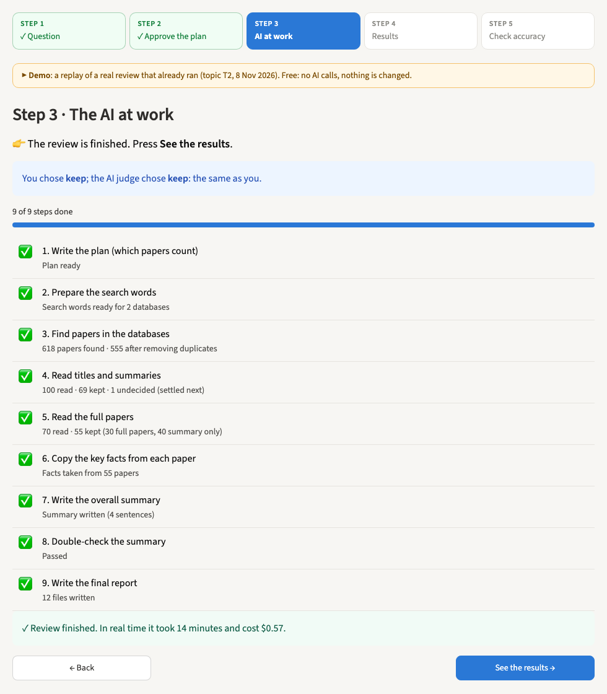
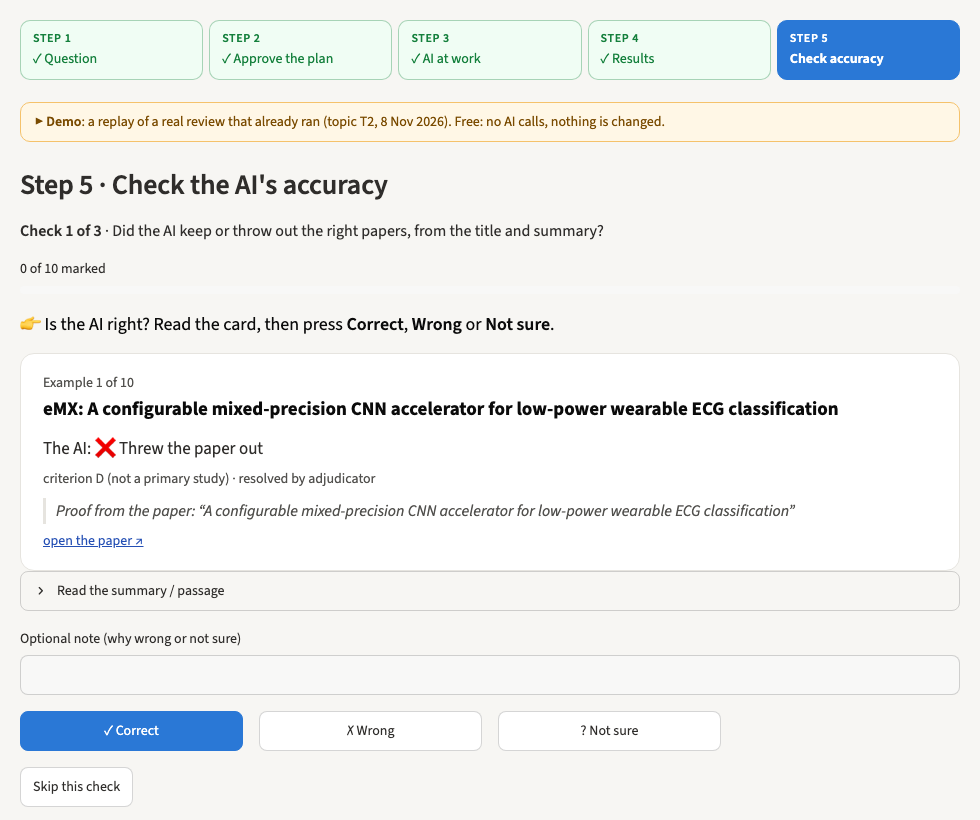
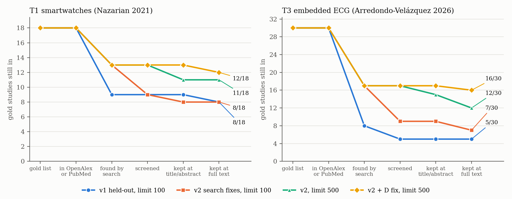
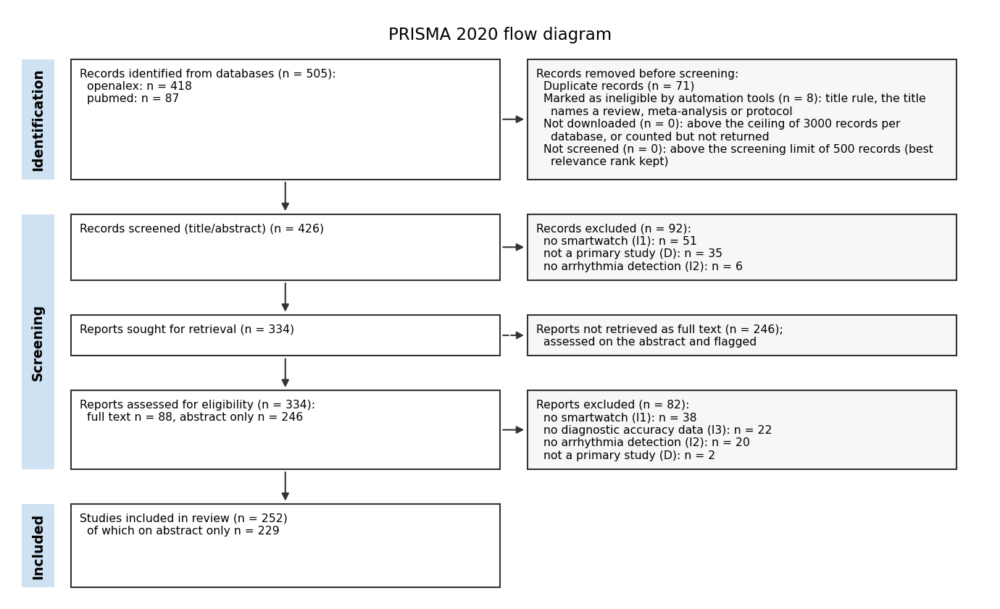

# Agentic Systematic Review Pipeline: technical report

**Yassir Tali**, M1, November 2026

The code is on GitHub: https://github.com/yassirtl/Agentic-SR-Pipeline. All the numbers in this report come from real runs of the system. The list of runs is in the appendix.

## Abstract

A systematic review collects all the studies on one question, filters them with fixed rules and summarises what they found. Done by hand, it takes months. I built a multi-agent system with LangGraph that does the whole review from one question, following PRISMA 2020: it writes the protocol, searches free databases, removes duplicates, screens titles, abstracts and full texts with two AI screeners and a judge, extracts the data, rates the risk of bias, writes the synthesis, checks it with a critic agent and writes a first draft of the review. An LLM coordinator chooses the next step, and plain code refuses any step that breaks the PRISMA order. Every exclusion and every extracted value must come with a quote, and code checks that the quote is really in the paper.

I tested the system against two reviews written by experts. On the first, untouched try, it kept 8 of their 18 studies (44%) and 5 of their 30 (17%). Most losses came from the search, not from the screening. After I fixed the search and one bug, it kept 67% and 53%, in under 30 minutes and for about one dollar per review. The price is precision: the system keeps many more papers than the experts did, and only about 5% of them are on the experts' lists. On a third topic with no expert review, I checked 30 random decisions by hand (not blind) and judged 29 correct. The system also ran end to end on a new question I typed in the app (26 studies included, 18 minutes, $0.29).

## 1. Introduction

Most of the time spent on a systematic review goes into reading: thousands of titles and abstracts, then hundreds of full papers, then extracting numbers from each one. Large language models read fast, but they also invent quotes and numbers, and their choices are hard to audit. My goal was a pipeline that is:

- **end to end:** from one question to a first draft of the review, in PRISMA 2020 format;
- **transparent:** every decision is logged with the text that justifies it;
- **reproducible:** running the same inputs again gives the same output, at no cost;
- **measured:** compared with reviews written by experts, so that its errors can be counted and explained.

## 2. How the system works

### 2.1 The LangGraph loop

The whole review is one LangGraph graph. All nodes share one state, the memory of the review: the protocol, the records, every decision and every table. The graph is a loop:

1. The run starts with the question.
2. A **coordinator** (an LLM) reads a short summary of the state (counts, flags, critic issues) and proposes the next stage, with a reason.
3. A **guardrail** (plain code) accepts the proposal only if the PRISMA order is respected and the stage has something new to do. Otherwise it refuses, runs the right stage instead and logs the refusal.
4. The stage runs and hands control back to the coordinator.
5. The loop ends when the report is written.

The nine stages follow PRISMA: planner, search strategy, retrieval, title/abstract screening, full-text screening, extraction, synthesis, critic and report. The graph pauses for a person at three points, using LangGraph's `interrupt`: to approve the protocol, to settle papers that the screeners and the judge could not agree on, and when the run reaches its cost limit. With `--auto`, nobody is asked anything. The state is saved after every step in SQLite, so a run that stops can be resumed where it stopped.

The guardrail never had to block a move out of PRISMA order. What it did catch were legal but useless moves: in early runs, the coordinator rebuilt the search 39 times because it read "0 records before retrieval" as a failed search. I added rules against repeating work: no new search once screening has kept papers, no re-run of a stage whose inputs did not change, and a stop when the same stage fails twice. In the final runs the coordinator made 2 to 3 such proposals per run, and each was refused.

### 2.2 The agents

| Agent | What the AI does | What code does |
|---|---|---|
| Coordinator | picks the next stage, with a reason | the guardrail accepts or refuses it |
| Planner | turns the question into a protocol: PICO, keep and throw-out rules, databases | applies the template; for test topics, uses the expert review's own rules |
| Search strategy | lists the concepts and their synonyms (and MeSH terms for PubMed) | builds one Boolean query per database, counts the hits, narrows or broadens |
| Retrieval | nothing | downloads from OpenAlex, PubMed, arXiv (Semantic Scholar also available) and removes duplicates |
| Title/abstract screening | a strict screener, a lenient screener, and a judge when they disagree; a verdict and a quote for each rule | checks every quote, decides from the verdicts, measures the agreement |
| Full-text screening | the same, on passages of the full paper found by RAG | downloads open-access full texts and builds the RAG index |
| Extraction and risk of bias | fills the data fields and rates the bias, each with a quote | accepts a value only if its quote is found in the paper |
| Synthesis | writes the summary as cited sentences | computes effect sizes and meta-analyses; checks every number and citation of the text |
| Critic | checks the synthesis, using LangChain tool calling (`lookup_study`, `outcome_summary`, `check_quote`) | runs its own checks; an AI objection blocks only if code confirms it; at most 2 loops back |
| Report | writes the Introduction, Discussion and Conclusions from facts prepared by code | builds the review draft, the PRISMA diagram, the evidence map and the gaps; checks every number and the 42-item PRISMA checklist |

The two screeners get opposite instructions on purpose: one excludes when in doubt, the other keeps. They copy the two human reviewers that PRISMA expects. When they disagree, the judge (adjudicator) decides, and when the judge cannot, a person does.

### 2.3 RAG over the full papers

Full papers are too long to send whole to the model, so screening and extraction use retrieval-augmented generation. Each open-access paper (PubMed Central XML or PDF) is cut into passages of about 250 words. The passages are searched in two ways, by meaning (OpenAI embeddings in a FAISS index) and by keywords (BM25). The two result lists are merged by reciprocal rank fusion, and the LLM re-ranks the best ones for each rule or data field. The index is built at full-text screening, because that is when the full texts are downloaded, and extraction reuses it. An optional compression step keeps only the sentences of each passage that match the question. It is off by default, because screening and extraction were evaluated without it.

### 2.4 Traceability and cost

Nothing is accepted without proof. An exclusion needs a quote, an extracted value needs a quote, and code checks that each quote is really in the paper. Every LLM call, database answer and embedding is cached on disk and logged in `audit.jsonl` with its tokens, cost and time. Running a finished review again, or rebuilding its report, costs $0. Each agent's model can be set separately; all runs used gpt-4o-mini at temperature 0, for cost.

### 2.5 The output: a review draft

The report stage writes a full review draft in PRISMA 2020 order (Markdown and Word): a structured abstract, introduction, methods, results, discussion, conclusions, references and appendices. Code builds everything that can be counted:

- the PRISMA flow diagram, with arithmetic checks;
- a table of the included studies;
- an **evidence map**, for example model type against device, with each study counted once;
- a summary of findings;
- the **evidence gaps**: combinations that no included study covers.

Each gap is then checked against all of OpenAlex, because a gap in my sample may only be a gap in my search. Only the gaps that hold go into a short research agenda. One LLM call writes the framing text from a sheet of facts; code rejects it if any number or study label is not in the facts, and code text replaces it. Finally, code checks the draft against the 42 items of the PRISMA 2020 checklist and adds the result as an appendix.

On the third test topic (T2, below), this found 8 gaps. Three were not confirmed by OpenAlex (for example, transformers: 2 studies in my sample, but 131 records in OpenAlex). The other five hold, including spiking neural networks on microcontrollers. The T3 run, a different and larger search, found the same gap.

### 2.6 The app

A Streamlit app (`sr-ui`) runs the same pipeline on the same run folders. My first version was a set of expert pages, and a first-time user could not tell where to start or when a step was finished. So I rebuilt it around one guided path of six steps: question, approve the plan, AI at work, results, check accuracy, read the review draft. Each screen has a step bar, one sentence saying what to do and one main button.

- **Demo** (free, no API calls): replays a finished review step by step from a small saved snapshot, and stops once on a real disagreement as a practice question.
- **Real review:** you type a question, choose how many records to screen (each option shows its estimated cost and time) and start. The run continues in the background, and the page shows each stage as it finishes.
- **Budget cap:** before each step, code compares the spend with the cap. When it is reached, the run pauses safely and can continue with a higher cap.
- **Check accuracy:** shows 10 random items per stage, one at a time (the decision, its quote and the passage behind it), and saves Correct, Wrong or Not sure.
- **Blind labels:** shows records with the rules but without the pipeline's decision, then scores the pipeline against your labels.

*Left: the demo after the replay (step 3), with the nine stages in plain words and the counts from the run. Right: one item of the accuracy check (step 5).*

## 3. How I evaluated it

### 3.1 Topics

| # | Expert review | Question | Expert studies |
|---|---|---|---|
| T1 | Nazarian 2021 | How accurate are smartwatches at detecting cardiac arrhythmias? | 18 |
| T2 | none (new review) | Which lightweight machine-learning models detect abnormal ECG on small devices, and how accurate and efficient are they? | none |
| T3 | Arredondo-Velázquez 2026 | Which machine-learning models classify ECG on embedded devices, and how accurate and efficient are they? | 30 |
| D0 | Li 2024 | Does exercise reduce depressive symptoms in older adults? | 15 |

For T1, T3 and D0, the pipeline got the expert review's question, rules and search dates. The experts' list of included studies is the "correct answer" (gold list). All T1 and T3 gold studies are in OpenAlex, so no loss comes from the choice of databases.

### 3.2 What was measured

The brief asks for four measures:

- **Completeness:** I followed each gold study through the stages (found by the search, inside the screening limit, kept after the abstract, kept after the full text) and gave each loss one cause.
- **Accuracy:** the share of my included studies that are on the gold list. This is a lower bound, because a study the experts did not list may still be eligible. For T2, which has no gold list, I also checked samples of decisions by hand.
- **Consistency between agents:** agreement between the two screeners (Cohen's kappa), the share of papers the judge had to decide, and the coordinator's refused moves.
- **Time saved:** the pipeline's time and cost, next to a manual estimate for the same work, using the default rates of the PredicTER tool (Haddaway and Westgate 2019): 192 abstracts, 44 full texts, 6.9 extractions and 11.7 quality appraisals per person-day.

### 3.3 What is a fair test, and what is not

I want to be clear about which results are untouched:

- **D0 was my development topic.** I tuned the screening rules on it, then froze them.
- **The first T1 and T3 runs are the fair test.** They ran with the frozen rules, before I changed anything because of their results.
- **Everything after that was fixed after seeing T1 and T3:** the search rules, a larger screening limit (500 records instead of 100) and a bug in the "primary study" rule. Those later numbers show what the improved system does on these topics. They are not a fair estimate for a new topic.
- **T2 helped me fix several rules,** so it is development data too. It has no gold list, so no recall is measured on it.

## 4. Results

### 4.1 Completeness, first try (fair test)

| Topic | Gold → found by search → screened → kept (abstract) → kept (full text) | Recall | Included (on gold list) | Cost, time |
|---|---|---|---|---|
| T1 | 18 → 9 → 9 → 9 → 8 | **44%** | 27 (8) | $0.27, 8 min |
| T3 | 30 → 8 → 5 → 5 → 5 | **17%** | 55 (5) | $0.49, 14 min |

The screening kept 13 of the 14 gold studies it saw. The losses were the search: 9 of 18 and 22 of 30 gold studies were never returned. The AI wrote long phrases like "classify ECG" where the experts searched single words like ECG and arrhythmia. For T3, the limit of 100 screened records also cut 3 gold studies that the search did find.

### 4.2 Completeness after the fixes

| Topic | Version | Recall | Included (share on gold list) | Cost, time |
|---|---|---|---|---|
| T1 | search fixed, 100 screened | 44% | 33 (24%) | $0.25, 7 min |
| T1 | search fixed, 500 screened | 61% | 102 (11%) | $0.75, 18 min |
| T1 | + bug fix, 500 screened (final) | **67%** | 252 (4.8%) | $1.04, 28 min |
| T3 | search fixed, 100 screened | 23% | 55 (13%) | $0.43, 10 min |
| T3 | search fixed, 500 screened | 40% | 231 (5.2%) | $1.62, 1.8 h |
| T3 | + bug fix, 500 screened (final) | **53%** | 293 (5.5%) | $0.52, 27 min |

Each fix helped, and each one had a cost:

- **Search fixes:** the search now found 13 of 18 and 17 of 30 gold studies (before: 9 and 8). But with only 100 records screened, many of them fell outside the limit.
- **Screening 500 records instead of 100:** recall rose by 17 points on both topics, but the included studies and the cost tripled or quadrupled.
- **Bug fix in the "primary study" rule:** the screeners had used it to throw out anything off-topic, quoting only the title, and this had removed 7 gold studies. After the fix, no gold study was lost on this rule, but more papers were kept.

Costs are not comparable between rows, because later runs reused cached answers from earlier ones. The T3 run at 500 records also includes 5 failed synthesis attempts.

**Where the remaining losses are.** In the final runs, the screeners kept **28 of the 30 gold studies they saw** (T1 12 of 13, T3 16 of 17). The search still misses 5 of 18 (T1) and 13 of 30 (T3). The weak part is the search, not the screening.

### 4.3 Accuracy

**Precision against the experts.** About 5% of my included studies are on the gold lists (T1 4.8%, T3 5.5%). This is a lower bound: some of my extra studies may be eligible, or newer than the expert review. But most are probably screening mistakes in the "keep" direction. About 90% of them (229 of 252, 256 of 293) were judged on the abstract only, because no free full text was available, and the rules forbid excluding a paper for missing information.

**T2: a check by hand (not blind).** T2 has no expert review, so I checked its last run myself. For three stages, 10 random items were drawn and I marked each one correct, wrong or unsure. I saw the pipeline's decision before judging, which favours agreement, so these are "judged correct by the author", not an independent accuracy.

| Stage | Sample | Correct | Wrong | Share correct (95% interval) |
|---|---|---|---|---|
| Title/abstract screening | 10 of 100 decisions | 10 | 0 | 100% (72% to 100%) |
| Full-text screening | 10 of 70 decisions | 9 | 1 | 90% (60% to 98%) |
| Extraction | 10 of 426 values with a quote | 10 | 0 | 100% (72% to 100%) |

With 10 items, 10 of 10 is still compatible with a true rate as low as 72%. All 10 full-text items were inclusions, so the sample says nothing about wrong exclusions there. Extraction was checked for correctness, not for what was missed. I prepared blind samples of 30 records, but did not label them.

### 4.4 Consistency between agents

| Run | Kappa, abstracts | Decided by the judge | Kappa, full texts | Coordinator moves refused |
|---|---|---|---|---|
| T1 final | 0.07 | 49% | 0.68 | 2 |
| T3 final | 0.007 | 76% | 0.84 | 3 |
| T2 | 0.06 | 66% | 0.74 | 1 |

The agreement on abstracts is low by design: one screener is strict and the other lenient, so on unclear abstracts they disagree and the judge decides. In practice, abstract screening is one screener plus a judge. On full texts, where there is more evidence, the two agree much more (kappa 0.68 to 0.84).

### 4.5 Time and cost

| Run | Records screened, full texts sought, studies included | Manual estimate (person-days) | Pipeline |
|---|---|---|---|
| T1 first try | 80, 38, 27 | 7.6 | 8 min, $0.27 |
| T3 first try | 100, 75, 55 | 15.1 | 14 min, $0.49 |
| T1 final | 434, 334, 252 | 68.9 | 28 min, $1.04 |
| T3 final | 432, 381, 293 | 79.5 | 27 min, $0.52 |
| T2 | 100, 70, 55 | 15.0 | 14 min, $0.57 |

For the same workload, PredicTER estimates 69 to 80 person-days of screening, extraction and appraisal; the pipeline took under half an hour for about one dollar. This comparison flatters the pipeline. Most of those manual days are extraction of my own included studies, and a human team would have excluded most of them first. Even so, extracting and appraising only the 18 gold studies of T1 would take about 4 person-days. Also, a person still has to check the pipeline's work. The estimate leaves out the protocol, the search design and the writing on both sides. The T1 and T3 final costs are lower than a fresh run would be, because of the cache; the first-try runs ($0.27 to $0.49) give a better idea.

### 4.6 A new question, started from the app

To check that the system works on a question it was never tested on, I started two reviews from the app by typing a question.

**"How much accuracy do large language models lose when they are quantized?"** The search found 4,367 records; 100 were screened and 95 kept for full reading. Full-text screening then crashed: one PDF returned a broken character (half of a math letter), and building the RAG index failed on it. I fixed this, added a test, and the fix is in the code. This run was not resumed.

**"Which quantized or pruned neural networks detect atrial fibrillation from single-lead ECG on microcontrollers or wearable devices, and what accuracy, memory and latency do they report?"** This review finished all nine stages with no help except plan approval and 6 conflict decisions: 89 records found, 34 kept after the abstracts, 13 full texts read, and **26 studies included** (21 of them on the abstract only). It took 18 minutes and cost $0.29. The critic passed with 4 warnings, the guardrail refused 1 coordinator move (a new search after screening), and the review draft was written in Markdown and Word. It has no gold list, so its recall is unknown. PubMed returned no record for this query, so all records came from OpenAlex.

### 4.7 Development topic D0

On D0 (exercise and depression in older adults, 15 gold studies), only 1 gold study survived to the end. Four are in Chinese journals that neither database indexes, four were not returned by the query, four were outside the 100 records screened, and two were lost at screening. Those two are three-arm trials: the judge excluded them by quoting the third arm, even though the prompt tells it not to. A code check would be needed to fix this; I did not add one because the screening rules were frozen.

## 5. Discussion

**The search is the weak link.** The screeners keep almost every gold study they see (28 of 30). Most losses happen before that, when the query never returns the study. The T3 experts searched four more databases and followed citations, but every T3 gold study is in OpenAlex, so the misses come from my queries, not from the databases.

**Recall is paid for with precision.** Every change that raised recall also raised the number of included papers. Because about 90% of the included papers had only an abstract, nothing could remove them. Keeping too much is the safe choice for a review, but it moves work to the person who must check the list.

**An AI coordinator needs limits on repetition, not only on order.** The guardrail never had to stop a move out of PRISMA order. What it stopped were useless repeats. This is a finding in itself: an LLM supervisor needs code limits on repeating work.

**Verified quotes make the system honest but cautious.** It writes "not reported" rather than invent a value. This explains the low share of extracted fields on abstracts (15% to 22%), and why no run had enough verified numbers for a meta-analysis. The syntheses are correct but say little. That is why the review draft adds what code can count without pooling: the evidence map, the summary of findings and the evidence gaps, each gap checked against OpenAlex.

## 6. Limitations

- **Only the first T1 and T3 runs are a fair test** (44% and 17%). The later numbers (67% and 53%) come from fixes made after seeing the results, and may be optimistic for a new topic.
- **Low precision** (about 5% of included studies are on the gold lists), and about 90% of the included studies were judged on the abstract only.
- **Low agreement on abstracts:** the judge does most of the work there.
- **The full-text rule reads passages, not the whole paper.** One gold study was lost because the word "smartwatch" was not in the 5 passages retrieved.
- **Weak synthesis on these topics:** almost no study reported numbers the code could verify and pool, so the review draft lists accuracy figures rather than comparing them.
- **No blind human labels:** T2's accuracy rests on my own check, not blind, of 10 items per stage on three stages.
- **The manual estimate** uses PredicTER's default rates (I did not read the paper itself) and the pipeline's own counts, which are inflated by the low precision.
- **The T2 review draft is based on a sample:** the run read the 100 most relevant of 555 records. Its gaps were checked against OpenAlex instead of a full run.
- **Free databases and open-access full texts only;** one model (gpt-4o-mini) for every agent.

## 7. Individual contribution

This is a solo project: I did every part of it.

- **Design:** the architecture (the LangGraph state, nine PRISMA stages, the LLM coordinator with a code guardrail, the human pauses, caching and cost tracking), the decisions log and the plan, written down step by step in `docs/PLAN.md`.
- **Pipeline:** the protocol template and planner; the search strategy and the four database connectors with deduplication; full-text download and the hybrid RAG index; dual screening with a judge, and the screening rules (tuned on a development topic, then frozen); extraction and risk of bias with verified quotes; synthesis and the tool-calling critic; the report, exports and command line.
- **Evaluation:** the choice of the test topics and expert reviews and their gold lists; the evaluation code (gold funnel, precision, agreement, time and cost); all real runs and their analysis, including the fixes made after seeing results, and saying so; the hand check of T2.
- **App and review draft:** the Streamlit app (guided review, free demo, live run with budget cap, accuracy check, blind labels, run details) and the review draft generator (study table, evidence map, summary of findings, gaps checked against OpenAlex, research agenda, PRISMA checklist).
- **Deliverables:** this report, the README user guide, the demo and the video.

## References

- Page MJ et al. The PRISMA 2020 statement. BMJ 2021;372:n71.
- Campbell M et al. Synthesis without meta-analysis (SWiM) in systematic reviews: reporting guideline. BMJ 2020;368:l6890.
- Nazarian S et al. Diagnostic accuracy of smartwatches for the detection of cardiac arrhythmia: systematic review and meta-analysis. J Med Internet Res 2021;23(8):e28974.
- Arredondo-Velázquez M. Evaluation protocols and on-chip feasibility in embedded electrocardiogram classification: a systematic review. Electronics 2026;15(21):5046. doi:10.3390/electronics15215046.
- Li X et al. Impact of exercise type, duration, and intensity on depressive symptoms in older adults: a systematic review and meta-analysis. Front Psychol 2024;15:1484172.
- Haddaway NR, Westgate MJ. Predicting the time needed for environmental systematic reviews and systematic maps. Conserv Biol 2019;33(2):434-443. doi:10.1111/cobi.13231.
- Haddaway NR, Westgate MJ. PredicTER: R package, https://github.com/nealhaddaway/predicter (default rates read in its R source, 2026-11-10).

## Appendix: runs used in this report

| Run | Topic and version | Run id |
|---|---|---|
| T1 first try | limit 100 | `20261108-173514-4dabd6` |
| T3 first try | limit 100 | `20261108-164532-b6cfd7` |
| T1 search fixed | limit 100 / 500 | `20261108-181121-3bbddf` / `20261108-183527-3491f8` |
| T3 search fixed | limit 100 / 500 | `20261108-181123-8431c1` / `20261108-183528-6c9efd` |
| T1 final | bug fix, limit 500 | `20261108-204319-7daa7f` |
| T3 final | bug fix, limit 500 | `20261108-204320-92ab19` |
| T2 | limit 100 (the app's demo) | `20261108-181125-158ae4` |
| D0 | limit 100 | `20261108-091009-f03123` |
| New question (AF) | from the app, limit 100 | `20261115-110627-5f123b` |
| New question (LLM quantization) | from the app, stopped at full-text screening | `20261115-101843-db236b` |
