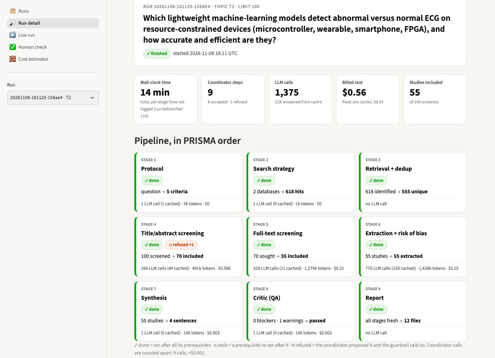
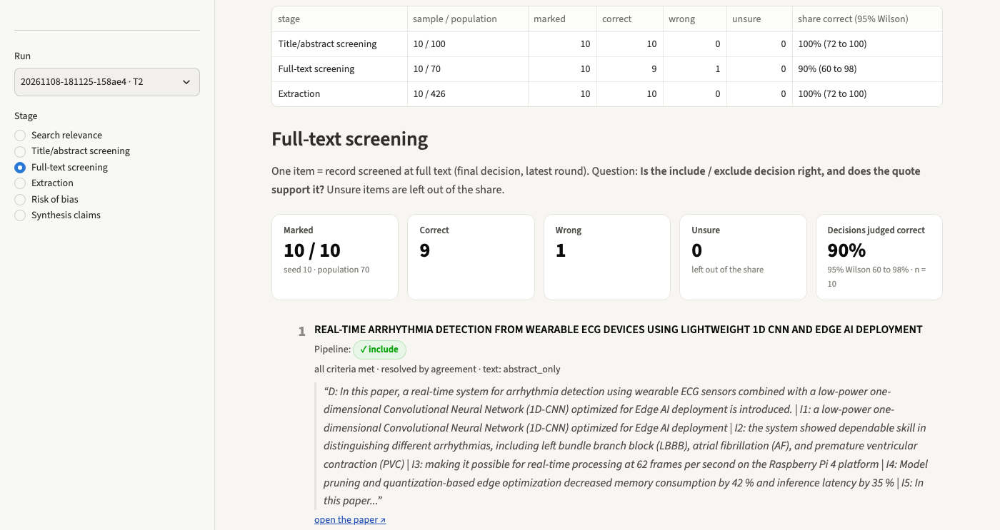
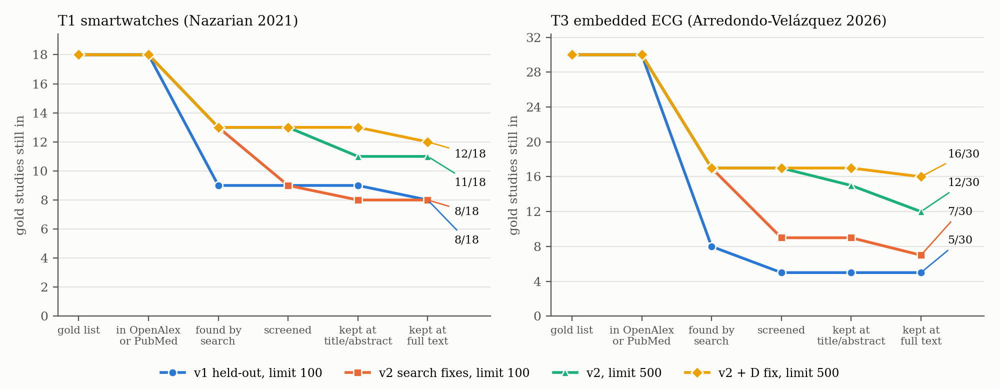
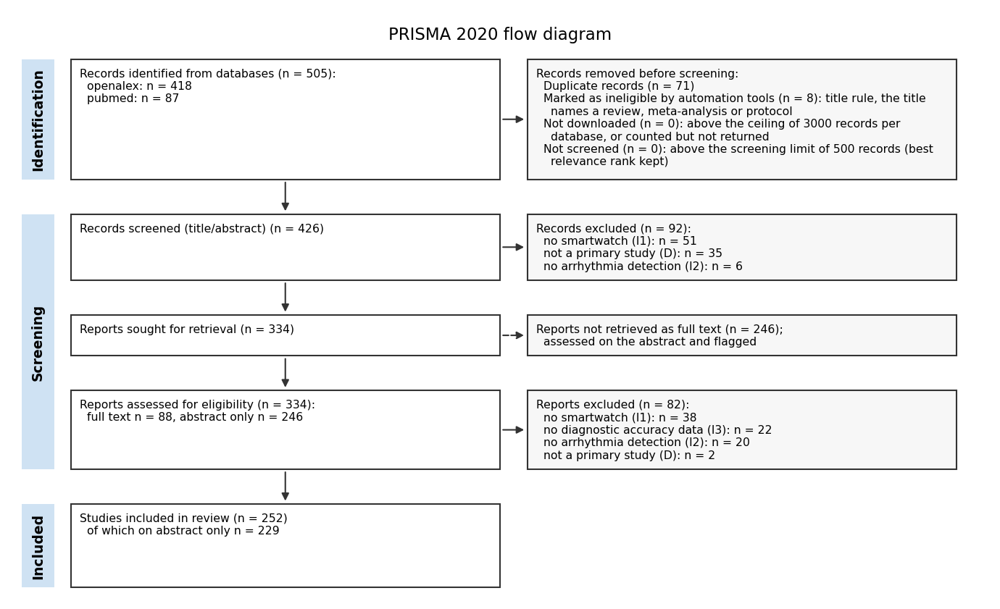
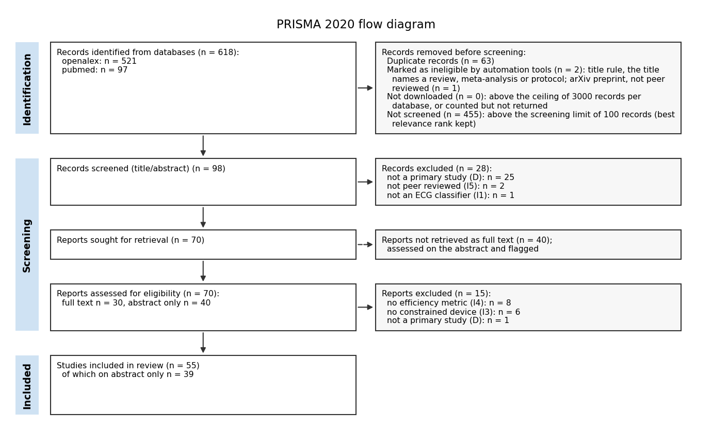
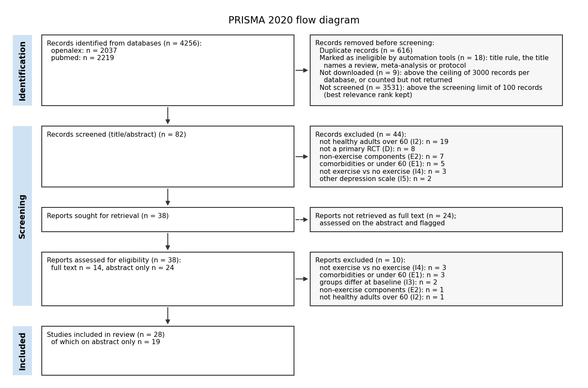

# Agentic Systematic Review Pipeline: technical report

2026-11-13 (first version 2026-11-10). Code: https://github.com/yassirtl/Agentic-SR-Pipeline. All numbers are computed by `python -m sr_pipeline.evaluation` from the runs named in the text; the evaluations are in `evaluation/results/`.

## Abstract

We built a multi-agent LangGraph system that runs a PRISMA 2020 systematic review from a single research question: protocol, search of three free databases, deduplication, dual title/abstract and full-text screening, data extraction, risk of bias, synthesis, quality check and report. An LLM coordinator chooses each next stage; code enforces PRISMA prerequisites and refuses useless re-runs. Every exclusion, extracted value and risk-of-bias judgment must rest on a quote that code finds in the source text, and every number in the narrative must appear in tables computed by code. We evaluate the pipeline on two published reviews (T1 smartwatches for arrhythmia, 18 studies; T3 ML ECG classifiers on embedded hardware, 30 studies), following each gold study through our stages, and on one new review without a published answer (T2). On the **held-out runs** (first version, 100 records screened, gpt-4o-mini) the pipeline kept 8 of 18 (44%) and 5 of 30 (17%) gold studies; the search was the weak link (9 and 8 gold studies found) while screening kept 13 of the 14 gold studies it saw. After search fixes, a larger screening limit (500) and a bug fix to the design criterion, all made **after** seeing these results, final recall rose to 67% (T1) and 53% (T3) for $1.04 and $0.52 of marginal API cost and under 30 minutes each. The price is precision: only 5% of our includes are gold studies (a lower bound, since an include missing from the gold list may still be eligible), and title/abstract screener agreement is near 0 (T3 from the start, kappa 0.04; T1 after the design fix, 0.42 → 0.07). The remaining losses are mostly the query (5 and 13 gold studies never returned). On T2, a check by the author (not blind) of 10 random items per stage judged 10 of 10 title/abstract decisions, 9 of 10 full-text decisions and 10 of 10 extracted values correct. A Streamlit interface shows each run stage by stage, starts reviews live under a budget cap, and runs this per-stage check.

## 1. Introduction

A systematic review takes months of expert time, most of it in screening and extraction. LLMs can read abstracts and full texts quickly, but they invent quotes and numbers and their decisions are hard to audit. The goal of this project is a pipeline that is (a) end to end: from a question to a PRISMA report; (b) transparent: each decision is logged with its evidence; (c) reproducible: a re-run of the same inputs gives the same output at no cost; and (d) evaluated against human reviews, so that its errors can be measured and explained.

## 2. System design

### 2.1 Orchestration

The state is one typed dictionary (`ReviewState`); lists written by several stages are append-only, and each item is tagged with its round so that a re-run never erases history. Nine stages follow the PRISMA order: `planner, search_strategy, retrieval, ta_screening, ft_screening, extraction, synthesis, critic, report`. After every stage the **coordinator** (an LLM) sees a summary of the state (counts, flags, critic issues, never the raw records) and proposes the next stage with a rationale. A code **guardrail** accepts the proposal only if all its prerequisites are *fresh* (they ran after their own prerequisites); otherwise it substitutes the earliest stale stage and logs the refusal. Rules added after the first real runs also refuse re-running a stage whose inputs did not change, searching again before retrieval has used the current strategy, searching again once screening has included records, and re-running synthesis before the critic has judged it; a stage that fails twice with the same error ends the run. A step budget (40) ends any loop. Two **human pauses** (LangGraph `interrupt`): protocol approval and screening conflicts the adjudicator cannot resolve; both are skipped with `--auto`. Runs are checkpointed in SQLite and can be resumed after a crash.

### 2.2 Agents

| Stage | What the LLM does | What code does |
|---|---|---|
| Planner | drafts PICO(S), criteria, outcome directions, a design suggestion | applies the template's scope; for evaluation topics, replaces the criteria with the gold review's |
| Search strategy | gives concepts (keywords, MeSH) and refines them on hit counts | builds each database's Boolean query, adds validated design filters and the topic's fixed setting block, removes generic task words and measurement-only outcome blocks, counts hits before downloading, narrows or broadens, stops a refinement that does not move the counts |
| Retrieval | none | downloads (OpenAlex, PubMed, arXiv), keeps each record's relevance rank, deduplicates (identifiers, then fuzzy title with guards) |
| Title/abstract screening | strict screener A, lenient screener B, adjudicator on disagreement; one verdict per criterion with a quote | verifies quotes, decides from the verdicts (an exclusion needs a verified quote), downgrades quotes that do not support their verdict (no evidence term, a study's own eligibility list, a D "no" without a non-primary word), title rule for reviews/protocols, arXiv rule for a peer-review criterion, Cohen's kappa |
| Full-text screening | same, on retrieved passages | fetches open-access full text (PMC XML, PDF), chunks it, hybrid retrieval (FAISS + BM25, rank fusion) and LLM re-ranking per criterion; an inclusion criterion still unclear with the full text available counts as not met |
| Extraction, risk of bias | fills fields and per-arm results with quotes; judges RoB domains | accepts a value only if its quote is found and prints every number of the value; chooses the RoB tool from the verified design (or the topic's instrument); computes overall judgments |
| Synthesis | writes the narrative as cited sentences | effect sizes, random-effects meta-analysis (≥ 3 studies) or SWiM vote count with sign test, forest plots; checks every number and citation of the text |
| Critic | looks for unsupported claims | code checks (coverage of outcomes, heterogeneity, conflicts, wording at high I²); an LLM objection becomes a blocker only when code confirms the wrong value; at most 2 loops back to synthesis |
| Report | none | PRISMA 2020 diagram with arithmetic checks, manuscript (Markdown, DOCX), CSV tables, BibTeX, run summary |

### 2.3 Reproducibility and cost

Every LLM call goes through one function that caches the answer on disk, keyed on model, schema and prompt, and records tokens and cost in the audit log. Database answers and embeddings are cached in the same way. A finished run can be re-run or its report rebuilt (`--report-only`) for $0. The model is configurable per agent; all agents used gpt-4o-mini (temperature 0). Costs below are what each run actually paid: when a run reuses cached answers from an earlier run, its cost is the marginal cost, not the cost of a cold run (the share of cached calls is given each time).

### 2.4 User interface

A Streamlit app (`sr-ui`) works on the same run folders and calls the same pipeline functions; it adds no backend. It has five pages.

- **Runs and Run detail** (read only, no API call). The nine stages are shown as cards in PRISMA order (first screenshot below). Each card gives its status (done, stale, not run, refused by the guardrail), counts in and out, LLM calls, tokens and billed cost. Tabs show the coordinator timeline (each proposal, accepted or refused, with the guardrail's reason and the coordinator's rationale), the PRISMA diagram, screening decisions with their deciding quote, extraction, risk of bias, synthesis and critic issues, the gold funnel and cost by stage. Every number is read from the run's files: on the 12 finished real runs the viewer matched `run_summary.json` and the evaluation files with 0 mismatches. Its "billed cost" card counts LLM calls only; the evaluation adds embeddings (T2: $0.56 vs $0.57).
- **Cost estimator.** Each finished run is projected to a chosen `--limit` and models, with the per-record and per-include rates measured in its audit log, and the page gives a low, median and high estimate (limit 500, over the 12 runs: $2.54 median, $1.19 to $4.37).
- **Live run.** A review (evaluation topic or free question, limit, budget cap) runs in a background thread with the same graph and SQLite checkpoint as the command line. Every 2 s the page re-reads the audit log: the running stage is highlighted, the cards show calls, cost and time per stage, and a bar shows the spend against the estimate and the cap. The human pauses are answered in forms (protocol approval with editable fields; conflicts with both screeners' votes and quotes) that send the same answers as the CLI. A stopped run is resumed from the Runs page.
- **Budget cap** (code, not the LLM). Before every coordinator step, the spend so far (billed LLM calls plus embeddings) is compared with the cap. At or above it, the run pauses cleanly (audit entry, checkpoint) and can be resumed with a higher cap or none. The check sits between stages, so the running stage is finished first and the spend can exceed the cap by one stage.
- **Human check, per stage.** For a run and a stage (search relevance, title/abstract, full text, extraction, risk of bias, synthesis claims), the page draws a seeded random sample of 5 to 20 items and shows each one with the pipeline's decision or value, its quote and the passage behind it (second screenshot below). The reviewer marks it correct, wrong or unsure, with an optional note. Marks are saved at once to `evaluation/stage_checks/<run>/<stage>.csv`, and `evaluate` reports the share correct with a Wilson 95% interval (section 4.5).

The live run, the pause forms and the budget cap were tested with the scripted fake LLM: Streamlit `AppTest` and a $0 browser pass, from start to report. No real (billed) run has been driven from the interface yet.

## 3. Evaluation method

### 3.1 Topics and gold standards

| # | Gold review | Question | Designs | Search end | Gold |
|---|---|---|---|---|---|
| T1 | Nazarian 2021, J Med Internet Res | How accurate are smartwatches at detecting cardiac arrhythmias? | any | 2021-02-28 | 18 |
| T2 | none (new review) | Which lightweight machine-learning models detect abnormal versus normal ECG on resource-constrained devices (microcontroller, wearable, smartphone, FPGA), and how accurate and efficient are they? | any | 2021 to run date | none |
| T3 | Arredondo-Velázquez 2026, Electronics | Which machine-learning models classify ECG on embedded devices (microcontroller, FPGA, ASIC or SoC), and how accurate and efficient are they? | any | 2021 to 2026-09-21 | 30 |
| D0 | Li 2024, Front Psychol | Does exercise reduce depressive symptoms in older adults? | RCT | 2024-01-07 | 15 |

Each run uses the review's question, design restriction, search window and eligibility criteria (T1: copied from Nazarian 2021's Methods; T3: the review's §2.3-2.4; D0: Li 2024); T2 has no published review, its criteria are ours. The gold lists were built from each review's table of included studies and reference list, identifiers copied from the references (T3: the 30 embedded implementations of its Table 2, references from the Crossref deposit). All T1 and T3 gold studies are in OpenAlex (PubMed: T1 17/18, T3 16/30), so no T1/T3 loss is due to the choice of databases. T2 and T3 also extract the engineering fields of the T3 review (dataset, partition, model size, platform, latency, energy...) and assess risk of bias with its five-domain instrument (protocol stated, inter-patient split, per-class metric, deployed variant, model size) instead of RoB 2 or QUADAS-2.

**Disclosure: what is held out and what is not.**

- **D0** (called T3 until the topics were revised on 2026-11-08) was the development topic: the search and screening rules were tuned on a 50-record sample containing two gold studies (tuning log in `docs/PLAN.md`, "Screening freeze"). Screening prompts and rules were frozen after that.
- **v1, held out:** the first T1 and T3 runs were made with the frozen screening and the 10b rules (which T2 had prompted, see below), before any change prompted by T1 or T3 results. A human approved each protocol without edits and answered the screening conflicts (T3: include). Their numbers are the held-out result of this project and are kept unchanged below. Later runs used `--auto`, which reproduces those answers.
- **v2 (Part 10c), post hoc:** search fixes (broadening rule, short keywords, setting/intervention merge, measurement-only outcome blocks and generic task words removed by code), made after seeing the v1 T1/T3 results. Search only; screening stayed frozen.
- **D fix (Part 10d), post hoc:** a bug fix made after seeing the limit-500 results: the 6b check "a D 'no' must quote a non-primary word" ran only for topics with a design list, and T1/T3 have none; 7 gold studies were lost on D quoting their bare title. The fix makes the existing check run for every topic; the word list is unchanged.
- **T2** results drove the 10b fixes (setting block, evidence terms, full-text absence rule, arXiv rule), so T2 is development data for those rules. It has no gold list, so no recall is measured on it in any case.

Post-hoc numbers show what the fixed pipeline does on these topics; they are not an unbiased estimate of performance on a new topic.

### 3.2 Metrics

The brief asks for completeness, accuracy, inter-agent consistency and time savings. All metrics are computed by code from a finished run (`python -m sr_pipeline.evaluation evaluate RUN`).

- **Completeness: the gold funnel.** Each gold study is followed through the stages *in our databases* (coverage lookup by DOI, PMID or title in OpenAlex and PubMed), *found by the search*, *inside the screening limit*, *kept at title/abstract*, *kept at full text*. A lost study gets one cause: the database choice, the query, the screening limit (a record above the limit is never counted as an exclusion), or the deciding criterion. Recall is reported against all gold studies and against covered ones (equal here for T1 and T3). Also: share of extraction fields reported with a verified quote; PRISMA arithmetic checks; critic outcome. For T2 and T3, extraction completeness counts only the topic's own 13 engineering fields (dataset, classes, partition, model, operations, parameters, arithmetic, memory, platform, clock, latency, power/energy, classification metrics): generic clinical fields (country, age, sex, comparator...) do not apply to a hardware study. The share over all fields is given next to it.
- **Accuracy.** Share of our includes that are gold studies: a lower bound on precision, since an include absent from the gold list may still be eligible. For T2, which has no gold list: a per-stage check by the author, not blind, on random samples of 10 items (section 4.5). The blind labelled title/abstract samples were not done (decision of 2026-11-10).
- **Inter-agent consistency.** Kappa between screeners A and B per stage (low by design: A is strict, B lenient), share sent to the adjudicator, coordinator refusals.
- **Time savings.** Wall-clock time, LLM calls and cost per run, next to a manual estimate for the same workload. The manual rates are the defaults of PredicTER (Haddaway and Westgate 2019), read in the package's R source: 192 abstracts, 44 full texts, 11.7 critical appraisals and 6.9 data extractions per reviewer-day, with 10% of screening decisions double-checked; days = items / rate × (1 + share checked). The source gives no length for a day, so the estimate stays in person-days and no "percent of time saved" is computed. We apply the abstract rate to every screened record, because the pipeline reads every abstract; PredicTER screens titles first (854 per day) and abstracts only for the titles kept, so this side of the estimate is high, but it is a small part of the total. The paper itself is not open access and was not read; its rates are taken as the package states them. For scale, the same authors estimate about 164 full-time-equivalent days for an average environmental systematic review.

## 4. Results

### 4.1 Held-out results (v1, limit 100)

| Topic | Run | Unique records | Gold: all → covered → found → screened → TA → FT | Final recall | Includes (gold share) | TA / FT kappa | Cost, time |
|---|---|---|---|---|---|---|---|
| T1 | `20261108-173514-4dabd6` | 80 | 18 → 18 → 9 → 9 → 9 → 8 | **44.4%** | 27 (8, 29.6%) | 0.46 / 0.54 | $0.27, 0.14 h |
| T3 | `20261108-164532-b6cfd7` | 278 | 30 → 30 → 8 → 5 → 5 → 5 | **16.7%** | 55 (5, 9.1%) | 0.04 / 0.81 | $0.49, 0.23 h |

Screening kept 13 of the 14 gold studies it saw (T1 lost Ding 2019 at full text on "smartwatch", I1); the losses are the search (T1: 9 of 18 never returned; T3: 22 of 30) and, for T3, the limit of 100 records (3 found gold studies at ranks 56, 94, 106). The queries explained the search losses: the LLM wrote long phrases ("classify ECG", "ML models") where the review's own search used single words (ECG, electrocardiogram, arrhythmia); T1 had a setting block that repeated the intervention and an outcome block of accuracy terms that narrowed the search, and missed common terms (Apple Watch, photoplethysmography). Only 80 (T1) and 278 (T3) unique records were found, so nothing pushed the search to broaden.

### 4.2 Post-hoc versions on the same topics

| Topic | Version | Run | Records screened | Gold funnel (found → screened → TA → FT) | Final recall | Includes (gold share) | TA kappa (adjudicated) | FT kappa | Cost (cached calls) | Time |
|---|---|---|---|---|---|---|---|---|---|---|
| T1 | v2, limit 100 | `181121-3bbddf` | 100 of 434 | 13 → 9 → 8 → 8 | 44.4% | 33 (24.2%) | 0.48 (25%) | 0.38 | $0.25 (180 of 843) | 0.11 h |
| T1 | v2, limit 500 | `183527-3491f8` | 434 | 13 → 13 → 11 → 11 | 61.1% | 102 (10.8%) | 0.42 (27%) | 0.61 | $0.75 (927 of 2,925) | 0.30 h |
| T1 | v2 + D fix, limit 500 | `204319-7daa7f` | 434 | 13 → 13 → 13 → 12 | **66.7%** | 252 (4.8%) | 0.07 (49%) | 0.68 | $1.04 (2,497 of 5,648) | 0.46 h |
| T3 | v2, limit 100 | `181123-8431c1` | 100 of 432 | 17 → 9 → 9 → 7 | 23.3% | 55 (12.7%) | 0.05 (68%) | 0.65 | $0.43 (388 of 1,310) | 0.17 h |
| T3 | v2, limit 500 | `183528-6c9efd` | 432 | 17 → 17 → 15 → 12 | 40.0% | 231 (5.2%) | 0.02 (69%) | 0.68 | $1.62 (1,477 of 5,375) | 1.84 h |
| T3 | v2 + D fix, limit 500 | `204320-92ab19` | 432 | 17 → 17 → 17 → 16 | **53.3%** | 293 (5.5%) | 0.007 (76%) | 0.84 | $0.52 (5,202 of 6,407) | 0.45 h |

Run ids start with 20261108. Three effects can be read separately:

- **Search fixes (v1 → v2, both limit 100).** The search found 13 of 18 (was 9) and 17 of 30 (was 8) gold studies, with 434 and 432 unique records. Final recall did not move on T1 (44.4%) and rose to 23.3% on T3, because the limit of 100 now cut the gold studies the search had gained (T1: 4 found gold studies at ranks 70-111; T3: 8 at ranks 53-320).
- **Screening limit (v2 at 100 → v2 at 500, same code).** Screening every record raised final recall by 16.7 points on both topics (44.4 → 61.1%, 23.3 → 40.0%). It also multiplied the includes by about 3 and 4 (33 → 102, 55 → 231) and the cost by 3 to 4.
- **D fix (v2 at 500, before → after).** No gold study was lost on D any more (T1 2 → 0, T3 5 → 0); final recall rose by 5.6 and 13.3 points to 66.7% and 53.3%. The includes rose again (T1 2.5×, T3 1.3×), and title/abstract agreement collapsed on T1 (kappa 0.42 → 0.07; T3 was already near 0: 0.04 in v1, 0.02 before the fix): before the fix, D was used as a catch-all, and both screeners agreed to exclude off-topic records "on D" quoting their title; now such a quote counts as unclear, screener A excludes on unclear and B does not, so the adjudicator decides about half (T1) to three quarters (T3) of the records.

Cost and time are not comparable across rows: later runs reuse cached answers from earlier ones (marginal cost), the T3 limit-500 run includes 5 failed synthesis rounds and a manual stop (the trigger of the repeated-failure rule), and both D-fix runs include a network outage and a `--resume`.

### 4.3 Final runs, stage by stage

**T1** (`20261108-204319-7daa7f`): 505 records identified (OpenAlex 418, PubMed 87), 434 after deduplication, all screened; 8 removed by the title rule, 92 excluded at title/abstract (I1 no smartwatch 51, D 35, I2 6), 334 sought, 246 without open-access full text (assessed on the abstract and flagged), 82 excluded at full text (I1 38, I3 no accuracy data 22, I2 20, D 2), **252 included, 229 of them on the abstract only**. Gold lost: 5 by the query (Corino 2017, Bashar 2019 [second paper], Väliaho 2019, Guo 2019, Seshadri 2020) and Ding 2019 at full text: screener A quoted the enrolment sentence without the word smartwatch, the evidence-term check made it unclear, the full-text absence rule turned it into "not met", and the adjudicator agreed. Ding was included by the pre-fix limit-500 run; the D fix did not touch it: the full-text index is built over the run's title/abstract includes, which changed with the fix, so BM25 ranked other passages for Ding and the screeners saw different text. Extraction: 846 of 4,536 fields (18.6%) with a verified quote (full text 59.4%, abstract only 14.6%). Synthesis: no included study had a usable 2×2 table, so no diagnostic pooling; the narrative is 10 grouped sentences. Critic passed (0 blockers, 3 warnings, 1 loop); PRISMA checks pass; the guardrail refused 2 coordinator proposals (a re-search after screening, a re-synthesis before the critic).

**T3** (`20261108-204320-92ab19`): 452 identified (OpenAlex 386, PubMed 66), 432 after deduplication; 16 removed by automation (title rule 5, arXiv rule 11), 35 excluded at title/abstract (D 22, I4 not peer reviewed 6, I1 5, I2 2), 381 sought, 263 without full text, 88 excluded at full text (I2 no embedded implementation 52, I3 no execution cost metric 28, I4 6, I1 2), **293 included, 256 on the abstract only**. Gold lost: 13 by the query (Raj 2018, Yin 2021, Cai 2021, one of the two Mangaraj 2025 papers, Zishan 2024, Mendoza 2025, two Wong 2022 papers, Wu 2019, Liu 2023, Saadatnejad 2020, Shan 2022, Mao 2022) and Xing 2022 at full text on I2 (no embedded implementation) by agreement of both screeners. Extraction: 945 of 3,809 topic fields (24.8%; full text 46.8%, abstract only 21.6%; all fields 23.0%). Risk of bias with the review's instrument: 266 unclear, 24 high, 3 low, mostly because the abstract does not report the domains. Synthesis: vote counting with 289 of 293 studies "not extractable" for accuracy (2 favour, 2 against), 9 grouped sentences. Critic passed (0 blockers, 2 warnings, 1 loop); PRISMA checks pass; 3 guardrail refusals.

**Screening alone.** Of the gold studies the screeners saw, T1 kept 13/13 at title/abstract and 12/13 after full text, T3 17/17 and 16/17.

### 4.4 T2: a new review (no gold standard)

T2 has no published answer, so no recall can be measured; its accuracy rests only on a check by the author of small samples (section 4.5). Three runs were made: the first (`20261108-114756-7b0e80`, $0.44) included 75 of 100 screened records, nearly all generic heartbeat classifiers with no device, because the query had no device concept and "yes" verdicts were given on quotes that did not support them; this triggered the 10b fixes. After them (`20261108-130150-5027ce`, $0.53) 44 were included, 41 of them mentioning a device. The last run (`20261108-181125-158ae4`, v2 search, limit 100, **before** the D fix: not comparable with the final T1/T3 runs) found 618 records (OpenAlex 521, PubMed 97), 555 unique, screened the 100 most relevant (455 not screened, shown in the diagram), excluded 28 at title/abstract (D 25) and 15 at full text (I4 no efficiency metric 8, I3 no constrained device 6, D 1), and **included 55, 39 on the abstract only**. TA kappa 0.06 (66% adjudicated), FT kappa 0.74; extraction 26.2% of topic fields; critic passed (1 warning, 0 loops); $0.57, 1,375 LLM calls, 0.23 h. Samples of its screening decisions and extracted values were checked by hand (section 4.5).

### 4.5 Accuracy on T2: per-stage human check (not blind)

T2 has no gold list, so its last run (`20261108-181125-158ae4`) was checked by hand on the Human check page (section 2.4). For three stages, a random sample of 10 items was drawn (seed 10) and the author marked each one correct, wrong or unsure. The check is **not blind**: the author saw the pipeline's decision and its quote before judging, which favours agreement. The numbers below are therefore "judged correct by the author on k of n sampled items", not an independent accuracy.

| Stage | Unit | Sample / population | Correct | Wrong | Unsure | Share judged correct (95% Wilson) |
|---|---|---|---|---|---|---|
| Title/abstract screening | final decision on a screened record | 10 / 100 | 10 | 0 | 0 | 100% (72.2% to 100%) |
| Full-text screening | final decision on a report sought | 10 / 70 | 9 | 1 | 0 | 90.0% (59.6% to 98.2%) |
| Extraction | a reported field of one study (value + quote) | 10 / 426 | 10 | 0 | 0 | 100% (72.2% to 100%) |

The one item judged wrong is a full-text include, "Atrial fibrillation detection with signal decomposition and dilated residual neural network" (no note recorded). How to read these numbers:

- **Small samples.** With 10 items, 10 of 10 is compatible with a true rate as low as 72%.
- **Full text: includes only.** All 10 full-text items drawn were includes (55 of the 70 reports sought were included), so the sample says nothing about wrong full-text exclusions. The title/abstract sample had 6 includes and 4 exclusions.
- **Extraction: correctness, not completeness.** The population is the 426 fields reported with a verified quote out of all 1,705 (25.0%, generic clinical fields included, so some sampled items are values such as "healthy subjects"). The check asks whether the reported values are right, not how many were missed.
- **Stages not checked:** search relevance, risk of bias and synthesis claims.
- **Not transferable.** The run screened only the 100 most relevant records and predates the D fix, so these numbers do not carry over to the final T1/T3 runs. In particular, they do not tell whether T1/T3's includes outside the gold lists are eligible (section 5).
- **Blind labels still not done.** Blind sheets of 30 records were prepared for D0 (`evaluation/labels/20261108-091009-f03123/`) and T2 (local, not in the repository), but labelling was skipped by decision of the author (2026-11-10).

### 4.6 Time and cost against a manual estimate

| Run | Records screened, full texts sought, studies included | Manual estimate (person-days: TA + FT + extraction + RoB) | Pipeline (wall clock, API cost) |
|---|---|---|---|
| T1 held-out v1 | 80, 38, 27 | 7.6 | 0.14 h, $0.27 |
| T3 held-out v1 | 100, 75, 55 | 15.1 | 0.23 h, $0.49 |
| T1 final | 434, 334, 252 | 68.9 (2.5 + 8.4 + 36.5 + 21.5) | 0.46 h, $1.04 |
| T3 final | 432, 381, 293 | 79.5 (2.5 + 9.5 + 42.5 + 25.0) | 0.45 h, $0.52 |
| T2 last run | 100, 70, 55 | 15.0 | 0.23 h, $0.57 |

For the same workload, the per-item stages that PredicTER puts at 69 (T1) and 80 (T3) person-days ran in under half an hour for about one dollar. This comparison flatters the pipeline in two ways. First, most of the manual days are extraction and risk of bias of our own includes, and with a precision floor of 5% a human team would have excluded most of them first. Even then the gap remains: extracting and appraising only the 18 gold studies of T1 would take 18 / 6.9 + 18 / 11.7 ≈ 4.1 person-days. Second, the pipeline's work is not checked: a human still has to read the protocol, the conflicts and the outputs. The estimate excludes protocol, search design, synthesis and writing on both sides. Costs of the final runs are marginal over the cache (T3: 5,202 of 6,407 calls cached); the held-out v1 runs, which were nearly cold (T1: 0 of 714 cached), give the better idea of a fresh run at limit 100: $0.27-0.49.

### 4.7 Development topic D0 (exercise and depression)

Run `20261108-091009-f03123` (`--topic T3 --limit 100`, made when D0 was called T3; evaluated with `--topic D0`): 4,256 records identified (OpenAlex 2,037, PubMed 2,219), 3,631 after deduplication, the 100 most relevant screened, 28 studies included (19 on abstract only). 1,420 LLM calls (686 from cache, after resumes), $0.37, 1.4 h wall clock (including a crash and its resume).

| Stage | Gold studies still in |
|---|---|
| gold list | 15 |
| in OpenAlex or PubMed | 11 |
| found by the search | 7 |
| inside the screening limit (100 records) | 3 |
| kept at title/abstract | 2 |
| kept at full text | 1 |

- **Coverage (4 lost):** An 2019, Guan 2017, Lyu 2012, Ma 2012 are in Chinese journals indexed by neither database.
- **Search (4 lost):** Laredo-Aguilera 2018, Apóstolo 2019, Kim 2021, Cunha 2022 are in the databases but not returned by our query.
- **Screening limit (4 lost):** Kim 2019, Chen 2015, Antunes 2005 and Prakhinkit 2014 were found (best database ranks 56, 65, 142, 382) but were outside the 100 records screened.
- **Screening (2 lost of 3 seen):** Shahidi 2011 and Huang 2015 are three-arm trials with a no-exercise control arm; the adjudicator named the exercise-vs-control pair and still excluded them on E2 "interventions beyond exercise", quoting the other arm (laughter yoga; CBT). The multi-arm rule is in the prompt but gpt-4o-mini does not follow it; a code check would be needed (not added: screening frozen). Makizako 2019 was included.
- **Precision:** 1 of 28 includes is a gold study (3.6%, lower bound). TA kappa 0.25 (44% adjudicated), FT 0.19. Extraction 258 of 392 fields (66%). Critic passed with 3 warnings.

## 5. Discussion

**Where the gold studies are lost.** The funnel turns one recall number into causes. On the held-out runs, screening kept 13 of the 14 gold studies it saw; the search and the screening limit lost the rest. After the post-hoc fixes the same holds: the screeners kept 28 of the 30 gold studies they saw across T1 and T3 (Ding and Xing lost at full text), while the query still misses 5 of 18 (T1) and 13 of 30 (T3). The T3 review searched four more databases (Web of Science, Scopus, IEEE Xplore, ScienceDirect) and used citation chasing; every gold study is in OpenAlex, so the misses are the query's, not the coverage's. Search is where the next gain is.

**Recall is bought with precision.** Each step that raised recall also raised the number of includes: limit 100 → 500 roughly tripled them, and the D fix multiplied T1's by 2.5. With 5% of includes in the gold list, our final sets are mostly studies the gold reviews did not include. Some may be eligible studies the reviews missed or that appeared after them, but most are probably screening errors made in the include direction, and the main reason is visible in the PRISMA diagrams: about 90% of includes (229/252, 256/293) were judged on the abstract only, where the rules forbid exclusion for missing information, so nothing can remove them. This is the conservative choice for a review (recall before precision), but it moves the work to the human who must check the includes.

**The D criterion as a catch-all.** Before the fix, D ("primary study") was the most frequent exclusion reason, and a sample showed why: the screeners used it for anything off-topic, quoting the title. The fix is right in principle (the non-primary word check already existed for topics with designs), and it removed every gold loss on D, but it also showed that the agreement between screeners had partly rested on that shortcut: on T1, TA kappa fell from 0.42 to 0.07 (T3 was already near 0) and the adjudicator now carries title/abstract screening.

**The coordinator needs limits on repetition.** The guardrail never had to block an illegal PRISMA move. What it caught were legal but useless moves: gpt-4o-mini read "0 records" before retrieval as a failed search and rebuilt the search 39 times in the first attempt, later re-screened unchanged inputs, and re-ran a failing synthesis 5 times. The rules added for this (no re-search before retrieval or after includes, no re-run of a fresh stage, stop on a repeated failure) are a finding in themselves: an LLM supervisor needs code limits on repetition, not only on order. In the final runs the coordinator made 11 steps each and 2-3 refusals.

**Verified quotes make the pipeline conservative.** It reports "not reported" rather than invent, which explains the low extraction shares on abstracts (14.6-21.6%) and why no synthesis had enough verified numbers for a meta-analysis or diagnostic pooling: T1 has no usable 2×2 table and T3 has 289 of 293 studies "not extractable". The syntheses are therefore generic grouped sentences; they are correct in the sense that every number and citation is checked, but they say little.

## 6. Limitations

- **Held-out vs post-hoc.** Only the v1 T1/T3 runs are held out (44% and 17%). The search fixes and the D bug fix were made after seeing T1/T3 results; T2 drove the 10b fixes. The final numbers (67%, 53%) may be optimistic for a new topic.
- **Low precision floor (~5%)** and many includes judged on the abstract only (about 90% in the final runs): the full-text absence rule cannot apply without a full text.
- **TA kappa near 0** (T3 in every version, T1 after the D fix): screeners A and B rarely agree; the adjudicator does the work, so dual screening is in practice single screening plus adjudication at title/abstract.
- **Full-text absence rule reads passages, not the paper.** Ding 2019 was lost because "smartwatch" was not in the 5 retrieved passages; the rule should search the whole full text before turning "unclear" into "not met" (future work). Because the index is built over each run's includes, the passages a screener sees depend on the other papers in the run (run-to-run variance).
- **Weak synthesis on these topics:** no usable 2×2 tables (T1), almost no extractable results (T3: 289/293 not extractable for accuracy), so only generic sentences.
- **No blind human-labelled sample:** on T1/T3 precision is a lower bound only and errors on non-gold records are not counted; T2's accuracy rests on a check by the author, not blind, of 10 items per stage on three stages (section 4.5).
- **Manual estimate:** rates from the PredicTER package (paper not read), a day of unknown length, the pipeline's own counts (inflated by low precision), screening, extraction and risk of bias only.
- **Costs** of the final runs are marginal over the LLM cache; wall clock includes outages and resumes.
- Free databases only (OpenAlex, PubMed, arXiv) and open-access full text only; one model (gpt-4o-mini) for every agent, stronger models tried only for the adjudicator; RoB 2 for the first outcome only; diagnostic pooling univariate; the D0 multi-arm error is reported, not fixed.

## 7. Individual contribution

[to write by the author: solo project; list the work packages (design, each part of docs/PLAN.md, evaluation, runs, video) in your own words]

## References

- Page MJ et al. The PRISMA 2020 statement. BMJ 2021;372:n71.
- Campbell M et al. Synthesis without meta-analysis (SWiM) in systematic reviews: reporting guideline. BMJ 2020;368:l6890.
- Nazarian S et al. Diagnostic accuracy of smartwatches for the detection of cardiac arrhythmia: systematic review and meta-analysis. J Med Internet Res 2021;23(8):e28974.
- Arredondo-Velázquez M. Evaluation protocols and on-chip feasibility in embedded electrocardiogram classification: a systematic review. Electronics 2026;15(21):5046. doi:10.3390/electronics15215046.
- Li X et al. Impact of exercise type, duration, and intensity on depressive symptoms in older adults: a systematic review and meta-analysis. Front Psychol 2024;15:1484172.
- Haddaway NR, Westgate MJ. Predicting the time needed for environmental systematic reviews and systematic maps. Conserv Biol 2019;33(2):434-443. doi:10.1111/cobi.13231.
- Haddaway NR, Westgate MJ. PredicTER: R package, https://github.com/nealhaddaway/predicter (default rates in R/abscreen.time.R, ftscreen.time.R, ca.time.R, dataextr.time.R; read 2026-11-10).
